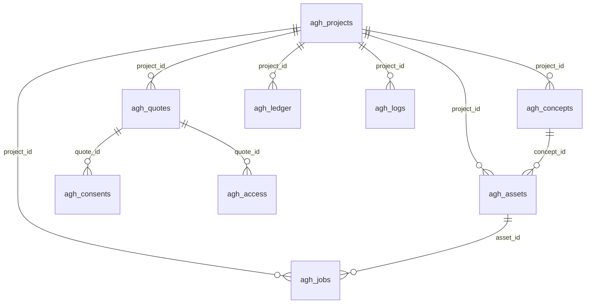

# AutoGroweHome – Adatbázis és tárolt állapot

Ez a dokumentum az AutoGroweHome 1.0.0 által tárolt összes adatot írja le:

- a 13 saját táblát oszloponként és indexenként, a sémaverziót és a migrációt;
- a `wp_options` bejegyzéseket, a tranzienseket, a felhasználói metaadatot és a sütiket;
- a cron eseményeket, a szerepköröket és a képességeket;
- az eltávolításkor törölt adatokat és az adatmegőrzési takarítást.

A forrás elsősorban az `includes/Installer.php` (a 2026-10-11-i, harmadik javítási kör utáni állapot, `AGH_DB_VERSION = 5`); a többi állítás mellett a fájl szerepel.

A fájlrendszerben tárolt képeket, tervvázlatokat és csomagokat az [ARCHITEKTURA.md 8. fejezete](ARCHITEKTURA.md#8-fájltárolás-supportstorage) írja le.

## Tartalom

1. [Áttekintés](#1-áttekintés)
2. [Táblák](#2-táblák)
3. [Sémaverzió és migráció](#3-sémaverzió-és-migráció)
4. [Opciók (wp_options)](#4-opciók-wp_options)
5. [Az agh_settings szerkezete](#5-az-agh_settings-szerkezete)
6. [Tranziensek](#6-tranziensek)
7. [Felhasználói meta és sütik](#7-felhasználói-meta-és-sütik)
8. [Cron események](#8-cron-események)
9. [Szerepkörök és jogosultságok](#9-szerepkörök-és-jogosultságok)
10. [Deaktiválás és eltávolítás](#10-deaktiválás-és-eltávolítás)
11. [Adatmegőrzés és takarítás](#11-adatmegőrzés-és-takarítás)
12. [Ellenőrzési megjegyzések](#12-ellenőrzési-megjegyzések)

---

## 1. Áttekintés

| Jellemző | Érték |
|---|---|
| Táblaprefix | `{$wpdb->prefix}agh_` (pl. `wp_agh_projects`) |
| Táblák száma | 13 (`Installer::tables()`) |
| Létrehozás | `dbDelta()`, `$wpdb->get_charset_collate()` karakterkészlettel (`Installer::migrate()`) |
| Táblanév a kódban | `Installer::table( 'projects' )` stb.; kulcsok: `projects`, `concepts`, `assets`, `jobs`, `quotes`, `consents`, `rate`, `stats`, `logs`, `prompt_versions`, `catalog`, `access`, `ledger` |
| Időbélyegek | `datetime` oszlopok UTC-ben; a `date` típusú `day` oszlopok a webhely időzónájában |
| JSON oszlopok | `longtext`, `Util::json()` / `Util::decode()` |
| Nyilvános azonosítók | `uuid` oszlopok (UUIDv4) |
| Idegen kulcsok | Nincsenek adatbázisszintű megkötések; a kapcsolatokat a kód kezeli |

---

## 2. Táblák

A típusok és az alapértékek szó szerint az `Installer::migrate()` `CREATE TABLE` utasításaiból származnak. „NN” = `NOT NULL`. A 4-es sémaverzió új elemei: `agh_quotes.recipients`, `agh_consents.user_agent`, `agh_access.recipient` és az `agh_access.quote_id` index.

### 2.1 agh_projects

| Oszlop | Típus | Alapérték | Leírás |
|---|---|---|---|
| `id` | bigint(20) unsigned NN AUTO_INCREMENT | – | Belső azonosító |
| `uuid` | char(36) NN | – | Nyilvános azonosító |
| `owner_user_id` | bigint(20) unsigned NN | 0 | WordPress-felhasználó; 0 = vendég |
| `guest_key_hash` | char(64) NN | `''` | A vendégsüti (`agh_gs`) HMAC-SHA256 kivonata |
| `name` | varchar(190) NN | `''` | Projektnév |
| `status` | varchar(20) NN | `'draft'` | `queued`, `planning`, `rendering`, `ready`, `partial`, `failed`, `cancelled`, `deleted` (anonimizált héj). A `draft` alapértéket a kód nem írja. |
| `config` | longtext NN | – | Tisztított konfiguráció (JSON; `_explicit` és `_auto` listával) |
| `config_hash` | char(64) NN | `''` | SHA-256 a konfigurációról a `project_name`, `house_name`, `_explicit` nélkül (duplikációszűrés) |
| `selected_concept_id` | bigint(20) unsigned NN | 0 | Kiválasztott koncepció |
| `prompt_version` | int(11) NN | 0 | Létrehozáskor aktív promptverzió |
| `lang` | varchar(12) NN | `''` | A kérés nyelve |
| `stage` | varchar(40) NN | `''` | `validate`, `prepare`, `exterior`, `gallery`, `done` |
| `ip_hash` | char(64) NN | `''` | Az IP-hálózat kulcsolt kivonata (`Ip::hash`; IPv6-nál `/64`); admin promptteszt esetén `admin-test`; anonimizáláskor üres |
| `saved` | tinyint(1) NN | 0 | 1 = mentett |
| `created_at`, `updated_at` | datetime NN | – | UTC |
| `expires_at` | datetime NULL | NULL | Fenntartott, a kód nem használja (a megőrzés az `updated_at`-ből és az aktuális beállításokból számol) |

Indexek: `PRIMARY (id)`, `UNIQUE uuid`, `owner_user_id`, `guest_key_hash`, `config_hash`, `status`.

### 2.2 agh_concepts

| Oszlop | Típus | Alapérték | Leírás |
|---|---|---|---|
| `id` | bigint(20) unsigned NN AUTO_INCREMENT | – | |
| `uuid` | char(36) NN | – | Nyilvános azonosító |
| `project_id` | bigint(20) unsigned NN | – | → `agh_projects.id` |
| `variant` | char(1) NN | `'A'` | `A`, `B`, `C` |
| `title` | varchar(190) NN | `''` | Koncepciónév |
| `brief` | longtext NN | – | JSON: a tervező kimenete (`name`, `name_en`, `tagline`, `differentiation`, `exterior_description`, `massing`, `materials`, `palette`, `signature_features`, `interior_mood`, `room_areas`, `client_wishes_en`, `source`) + `warnings`, `planner` |
| `building` | longtext NN | – | JSON: `agh-building-v1` ([FEJLESZTOI-DOKUMENTACIO.md 5.](FEJLESZTOI-DOKUMENTACIO.md#5-épületmodell-agh-building-v1)) |
| `consistency_id` | char(16) NN | `''` | `sha256( uuid . '|' . parts-JSON )` első 16 karaktere |
| `status` | varchar(20) NN | `'planned'` | `planned`, `ready`, `failed` |
| `gallery_status` | varchar(20) NN | `'none'` | `none`, `pending`, `rendering`, `ready`, `failed` |
| `revision` | int(11) NN | 1 | Konfigurációmódosítással járó újragenerálásnál nő |
| `created_at`, `updated_at` | datetime NN | – | UTC |

Indexek: `PRIMARY (id)`, `UNIQUE uuid`, `project_id`.

### 2.3 agh_assets

| Oszlop | Típus | Alapérték | Leírás |
|---|---|---|---|
| `id` | bigint(20) unsigned NN AUTO_INCREMENT | – | |
| `uuid` | char(36) NN | – | Nyilvános azonosító |
| `project_id` | bigint(20) unsigned NN | – | → `agh_projects.id` |
| `concept_id` | bigint(20) unsigned NN | 0 | → `agh_concepts.id` |
| `kind` | varchar(20) NN | `'render'` | `render`, `plan`, `doc` |
| `view` | varchar(40) NN | `''` | pl. `hero`, `front`, `interior_r2`, `plan_0`, `building_json`, `dxf`, regisztrált exporter azonosítója |
| `label` | varchar(190) NN | `''` | Felirat |
| `status` | varchar(20) NN | `'queued'` | `queued`, `running`, `done`, `failed`, `cancelled`, `archived` |
| `provider` | varchar(40) NN | `''` | `magnific`, `test`, regisztrált azonosító; `agh-svg`, `agh` |
| `model` | varchar(60) NN | `''` | pl. `mystic/realism`, `flux-2-pro`, `test-massing`, `upscaler`, `BuildingModel 1.0.0` |
| `provider_task_id` | varchar(100) NN | `''` | Magnificnál `<végpont>|<task-uuid>`, teszt szolgáltatónál `local` |
| `prompt` | longtext NULL | – | Az elküldött prompt (≤3900 karakter) |
| `file_path`, `preview_path` | varchar(255) NN | `''` | Relatív útvonalak a védett tárhelyen |
| `mime` | varchar(60) NN | `''` | pl. `image/png`, `image/svg+xml`, `text/csv`, `application/json`, `application/dxf`, exporter MIME-típusa |
| `width`, `height` | int(11) NN | 0 | Pixelméret |
| `bytes` | bigint(20) NN | 0 | Fájlméret |
| `native_resolution` | varchar(10) NN | `''` | Kért felbontás |
| `is_upscaled`, `is_test` | tinyint(1) NN | 0 | Felskálázott / teszt mód |
| `access_level` | varchar(20) NN | `'contractor'` | `client`, `contractor`, `admin` |
| `version` | int(11) NN | 1 | Nézetenként nő (újragenerálás, galéria-újrakészítés, felskálázás) |
| `gen_ms` | int(11) NN | 0 | Létrehozástól tárolásig, ms (másodperces pontossággal) |
| `cost` | decimal(12,4) NN | 0 | Becsült költség |
| `error` | text NULL | – | Utolsó hibaüzenet |
| `sort` | int(11) NN | 0 | 0: fő kép; 1…: nézetek; 20…: belső nézetek; 100…: tervvázlatok és dokumentumok |
| `created_at`, `updated_at` | datetime NN | – | UTC |

Indexek: `PRIMARY (id)`, `UNIQUE uuid`, `project_id`, `concept_id`, `status`.

### 2.4 agh_jobs

| Oszlop | Típus | Alapérték | Leírás |
|---|---|---|---|
| `id` | bigint(20) unsigned NN AUTO_INCREMENT | – | |
| `project_id` | bigint(20) unsigned NN | 0 | |
| `asset_id` | bigint(20) unsigned NN | 0 | Render és upscale feladatnál |
| `type` | varchar(30) NN | – | `plan`, `render`, `upscale`, `package`, `notify` |
| `payload` | longtext NULL | – | JSON, pl. `{"op":"hero"}`, `{"reserved":[…],"lang":"hu_HU"}` (plan), `{"op":"hero","regenerate":true,"reserved":[…]}` (újragenerálás), a visszatérítés után `"refunded":"<UTC>"` jelöléssel (`JobQueue::refund_job_once()`), `{"quote":12,"wait_since":…}`, `{"phase":"submit","task":"…"}` (felskálázás; a `wait()` a meglévő payloadba fésüli a `task` kulcsot), `{"provider":"test"}` (tartalék szolgáltatóra váltás) |
| `status` | varchar(20) NN | `'queued'` | `queued`, `waiting`, `running`, `done`, `failed`, `cancelled` |
| `priority` | tinyint(3) unsigned NN | 10 | Kisebb = előbb |
| `attempts` | tinyint(3) unsigned NN | 0 | Foglalásonként nő; a `wait()` eggyel csökkenti, így a várakozás nem fogyaszt próbálkozást |
| `max_attempts` | tinyint(3) unsigned NN | 3 | |
| `run_after` | datetime NN | – | Legkorábbi futás |
| `locked_until` | datetime NULL | NULL | Zárolás lejárata (`JobQueue::lock_seconds()`, alapértékekkel 513 s) |
| `lock_token` | char(32) NN | `''` | A foglaló worker tokenje; a `complete()`/`wait()`/`fail()` csak egyezésnél ír |
| `started_at` | datetime NULL | NULL | Első foglalás |
| `last_error` | text NULL | – | ≤2000 karakter |
| `created_at`, `updated_at` | datetime NN | – | UTC |

Indexek: `PRIMARY (id)`, `pick (status, run_after, priority)`, `project_id`. A `plan` feladat `reserved` listája a lefoglalt keretegységeket tartalmazza (`JobQueue::reserved_for()`).

### 2.5 agh_quotes

Ajánlatkérés: személyes adatokat tartalmaz.

| Oszlop | Típus | Alapérték | Leírás |
|---|---|---|---|
| `id` | bigint(20) unsigned NN AUTO_INCREMENT | – | |
| `uuid` | char(36) NN | – | Nyilvános azonosító |
| `project_id` | bigint(20) unsigned NN | – | → `agh_projects.id` |
| `concept_id` | bigint(20) unsigned NN | 0 | A választott koncepció |
| `full_name` | varchar(190) NN | `''` | Anonimizálás után `[törölve]` |
| `email`, `phone`, `city`, `site_location`, `start_period`, `budget` | varchar (190/60/120/190/60/60) NN | `''` | Anonimizáláskor mind üres |
| `note` | text NULL | – | Anonimizáláskor üres |
| `lang` | varchar(12) NN | `''` | Az ügyfél nyelve |
| `status` | varchar(20) NN | `'pending'` | `pending`, `notified`, `notify_failed` |
| `package_path` | varchar(255) NN | `''` | A ZIP relatív útvonala |
| `notified_at` | datetime NULL | NULL | Sikeres értesítés |
| `downloads` | int(11) NN | 0 | Csomagletöltések |
| `recipients` | longtext NULL | – | **Új (v4).** Címzettenkénti kézbesítési állapot JSON-ban: `{ "to": { "<kivitelezői e-mail>": { "status": "sent\|failed", "round": <notify feladat id>, "at": "<UTC>" } }, "client": "<az ügyfél-visszaigazolás UTC ideje>" }` (`QuoteService::delivery()`) |
| `anonymized` | tinyint(1) NN | 0 | 1 = személyes adatok törölve |
| `created_at`, `updated_at` | datetime NN | – | UTC |

Indexek: `PRIMARY (id)`, `UNIQUE uuid`, `project_id`, `email`.

### 2.6 agh_consents

| Oszlop | Típus | Alapérték | Leírás |
|---|---|---|---|
| `id` | bigint(20) unsigned NN AUTO_INCREMENT | – | |
| `quote_id` | bigint(20) unsigned NN | 0 | → `agh_quotes.id` |
| `project_id` | bigint(20) unsigned NN | 0 | |
| `consent_type` | varchar(30) NN | – | `terms`, `privacy`, `contact`, `marketing`; továbbításnál `forwarding` |
| `granted` | tinyint(1) NN | 0 | Megadva / sikeres továbbítás (`forwarded`, `forwarded_partial`) |
| `doc_version`, `doc_url` | varchar(40) / varchar(255) NN | `''` | A dokumentum verziója és URL-je a beküldéskor |
| `event` | varchar(30) NN | `'given'` | `given`, `forwarded`, `forwarded_partial`, `forward_failed` |
| `ip_hash` | char(64) NN | `''` | IP-kivonat; anonimizáláskor üres |
| `user_agent` | varchar(255) NN | `''` | **Új (v4).** Csak ha `legal.store_user_agent` igaz; anonimizáláskor üres; a portálra és a csomagba nem kerül ki |
| `created_at` | datetime NN | – | UTC |

Indexek: `PRIMARY (id)`, `quote_id`.

### 2.7 agh_rate

| Oszlop | Típus | Alapérték | Leírás |
|---|---|---|---|
| `bucket` | char(64) NN | – | IP-hash; felhasználónál `sha256('user|<id>')`; globálisnál `sha256('global')` |
| `period` | varchar(20) NN | – | Nap (`ÉÉÉÉ-HH-NN`) vagy burst-ablak (`w<n>`) |
| `scope` | varchar(20) NN | – | `ip`, `user`, `global`, `burst`; újragenerálás: `gallery` (IP), `gallery_user` (felhasználó); kiegészítő: `interpret` (15/nap), `quote` (5/nap), `portal` (30/nap), `webhook` (2000/nap), `ev_popup_open`, `ev_design_start` (50/nap) |
| `hits` | int(11) NN | 0 | Felhasznált egységek |
| `updated_at` | datetime NN | – | UTC |

Index: `PRIMARY (bucket, period, scope)`. Foglalás: `INSERT IGNORE` + feltételes `UPDATE … WHERE hits < limit`.

### 2.8 agh_stats

| Oszlop | Típus | Alapérték | Leírás |
|---|---|---|---|
| `day` | date NN | – | Nap |
| `metric` | varchar(64) NN | – | `Stats::METRICS`: `popup_open`, `design_start`, `design_complete`, `generate_request`, `concepts_ready`, `image_ok`, `image_fail`, `gen_ms`, `gen_count`, `cost`, `style`, `roof`, `area_bucket`, `param`, `project_saved`, `quote_submitted`, `package_download`, `error`, `provider_ok`, `provider_fail`, `limit_hit`; továbbá `hero_download` |
| `dim` | varchar(100) NN | `''` | Bontás; `''` = összesen |
| `value` | double NN | 0 | Halmozott érték |

Index: `PRIMARY (day, metric, dim)`.

### 2.9 agh_logs

| Oszlop | Típus | Alapérték | Leírás |
|---|---|---|---|
| `id` | bigint(20) unsigned NN AUTO_INCREMENT | – | |
| `level` | varchar(10) NN | `'info'` | `info`, `warning`, `error` |
| `channel` | varchar(40) NN | `'core'` | A kódban: `admin`, `cad`, `core` (adatfrissítés), `gdpr`, `license`, `mail`, `package`, `planner`, `portal`, `queue`, `render`, `rest` |
| `message` | text NN | – | ≤2000 karakter, titokszűrve |
| `context` | longtext NULL | – | JSON, titokszűrve |
| `project_id` | bigint(20) unsigned NN | 0 | |
| `created_at` | datetime NN | – | UTC |

Indexek: `PRIMARY (id)`, `level`, `created_at`.

### 2.10 agh_prompt_versions

| Oszlop | Típus | Alapérték | Leírás |
|---|---|---|---|
| `id` | bigint(20) unsigned NN AUTO_INCREMENT | – | |
| `version` | int(11) NN | – | Növekvő verziószám |
| `label` | varchar(190) NN | `''` | pl. „Gyári alapértelmezés (2. kiadás)” |
| `modules` | longtext NN | – | JSON: `{ "modules": {…}, "views": {…}, "style_overrides": {…} }` |
| `created_by` | bigint(20) unsigned NN | 0 | |
| `is_active` | tinyint(1) NN | 0 | Egyszerre egy aktív |
| `created_at` | datetime NN | – | UTC |

Indexek: `PRIMARY (id)`, `UNIQUE version`. A gyári frissítés (`PromptEngine::maybe_upgrade_defaults()`) új sort ír, a meglévőket nem módosítja.

### 2.11 agh_catalog

| Oszlop | Típus | Alapérték | Leírás |
|---|---|---|---|
| `id` | bigint(20) unsigned NN AUTO_INCREMENT | – | |
| `type` | varchar(40) NN | – | `roof_brand`, `roof_product`, `material`, `color_collection`, `style`, `interior_collection`, `preset` |
| `slug` | varchar(100) NN | – | |
| `name` | varchar(190) NN | `''` | |
| `data` | longtext NULL | – | JSON. Márkánál `required` (kötelező márka); terméknél `brand`, `recommended`/`default` (ajánlott), `colors`, `verified` (gyártói ellenőrzés; a felület a hamis értéket „Gyártói ellenőrzésre vár” jellel mutatja) stb. Mentéskor (`Catalog::save()`) a be nem küldött kulcsok megmaradnak. |
| `image_id` | bigint(20) unsigned NN | 0 | Médiatár-melléklet |
| `sort` | int(11) NN | 0 | |
| `status` | varchar(20) NN | `'published'` | `published` vagy `hidden` |
| `created_at`, `updated_at` | datetime NN | – | UTC |

Indexek: `PRIMARY (id)`, `UNIQUE type_slug (type, slug)`.

A BRAMAC márka (`roof_brand` / `bramac`, `Catalog::SPEC_ROOF_BRAND`) mentéskor mindig `required = true` és `published` marad, és nem törölhető: a `Catalog::delete()` `false`-t ad, az admin hibaüzenetet mutat.

### 2.12 agh_access

| Oszlop | Típus | Alapérték | Leírás |
|---|---|---|---|
| `id` | bigint(20) unsigned NN AUTO_INCREMENT | – | |
| `kind` | varchar(20) NN | `'link'` | `link`, `session` |
| `token_hash` | char(64) NN | – | `HMAC-SHA256(token, wp_salt('secure_auth'))` |
| `quote_id` | bigint(20) unsigned NN | 0 | |
| `project_id` | bigint(20) unsigned NN | 0 | |
| `recipient` | char(64) NN | `''` | **Új (v4).** A címzett e-mail-címének HMAC-je (`AccessTokens::recipient_hash()`); a munkamenet a link címzettjét örökli. A v4 előtti linkeknél üres. |
| `uses` | int(11) NN | 0 | Cserék száma |
| `max_uses` | int(11) NN | 0 | 0 = korlátlan a lejáratig (a kód mindig így hozza létre) |
| `expires_at` | datetime NN | – | `contractor.link_hours` / `contractor.session_hours` |
| `revoked` | tinyint(1) NN | 0 | Visszavonva |
| `created_at` | datetime NN | – | UTC |

Indexek: `PRIMARY (id)`, `UNIQUE token_hash`, `project_id`, `quote_id` (új, v4).

### 2.13 agh_ledger

| Oszlop | Típus | Alapérték | Leírás |
|---|---|---|---|
| `id` | bigint(20) unsigned NN AUTO_INCREMENT | – | |
| `day` | date NN | – | |
| `provider` | varchar(40) NN | – | `anthropic`, `magnific`, más szolgáltató |
| `operation` | varchar(40) NN | – | `plan`, `interpret`, `mystic_2k`, `mystic_4k`, `reference_image`, `upscale` |
| `units` | double NN | 1 | `plan`-nél a tokenek összege |
| `cost` | decimal(12,4) NN | 0 | Becsült költség (`costs.*`) |
| `project_id`, `asset_id` | bigint(20) unsigned NN | 0 | |
| `created_at` | datetime NN | – | UTC |

Indexek: `PRIMARY (id)`, `day`, `project_id`.

---

## 3. Sémaverzió és migráció

| Elem | Működés | Forrás |
|---|---|---|
| Célverzió | `AGH_DB_VERSION = 5` | `autogrowehome.php` |
| Tárolt verzió | `agh_db_version` opció | `Installer::migrate()` |
| Ellenőrzés | Minden kérésnél (`plugins_loaded`): `Installer::maybe_upgrade()`; ha a tárolt érték kisebb, lefut a `migrate()`, az `upgrade_data( $from )`, a `roles()` és a `Settings::install_defaults()` | `includes/Installer.php` |
| Migráció | Nincsenek lépésenkénti szkriptek: mind a 13 `CREATE TABLE` a `dbDelta()`-n fut át. A hiányzó táblák, oszlopok és indexek létrejönnek (3 → 4: `recipients`, `user_agent`, `recipient`, `quote_id` index); oszlopot nem töröl és nem nevez át. A 4 → 5 lépés sémát nem változtat. | `Installer::migrate()` |
| Adatfrissítés | Verzióhoz kötött, egyszeri, idempotens lépések (`Installer::upgrade_data( $from )`, aktiváláskor is). v5: a tárolt kulcsok újratitkosítása a jelenlegi kulccsal és formátummal (`Secrets::upgrade_storage()`); az eredmény a naplóba kerül (`core` csatorna). | `Installer::upgrade_data()` |
| Beállítások | Alapértékek összefésülése a tárolttal (a tárolt nyer, a listák felülíródnak) | `Settings::install_defaults()` |
| Szerepkörök | `add_role` csak nem létező szerepkörnél; az adminisztrátor a 4 képességet mindig megkapja | `Installer::roles()` |
| Titkok | A régi formátumú (`o1:`) vagy régi kulccsal titkosított érték olvasáskor is újratitkosul | `Secrets::get()` |
| Gyári promptok | Az aktív, érintetlen régi gyári verzió helyett új gyári verzió jön létre és aktiválódik, egyszer revíziónként (`agh_prompt_defaults_rev`) | `PromptEngine::maybe_upgrade_defaults()` |
| Aktiválás | `migrate()`, `roles()`, `install_defaults()`, `Storage::ensure_private_dir()`, `Catalog::seed()`, `PromptEngine::seed()`, cron ütemezés, `agh_activated_at` | `Installer::activate()` |

---

## 4. Opciók (wp_options)

A plugin az opciókat `autoload = no` beállítással írja, **kivéve** az `agh_prompt_defaults_rev` opciót (`autoload = yes`).

| Opció | Tartalom | Írja | Olvassa |
|---|---|---|---|
| `agh_settings` | Minden beállítás csoportokban (5. fejezet) | `Settings::install_defaults()`, `update_group()` | `Settings::all()`, `uninstall.php` |
| `agh_secrets` | Titkosított kulcsok: `anthropic_api_key`, `magnific_api_key`, `license_key` (`s1:`, `o2:`, régi `o1:`). A kulcs `AGH_SECRET_SALT`-ból, ennek hiányában a WordPress-sókból származik ([API-INTEGRACIOK.md 1.2](API-INTEGRACIOK.md#12-hol-adhatók-meg-a-kulcsok)). | `Secrets::set()`, `upgrade_storage()` | `Secrets::get()` |
| `agh_db_version` | Sémaverzió | `Installer::migrate()` | `Installer::maybe_upgrade()` |
| `agh_activated_at` | Aktiválás időbélyege | `Installer::activate()` | – |
| `agh_private_suffix` | A védett tárhely utótagja | `Storage::base_dir()` | `Storage` |
| `agh_catalog_seeded` | Kezdő katalógus feltöltve | `Catalog::seed()` | `Catalog::seed()` |
| `agh_custom_params` | Egyedi paraméterek (`x_` előtag). A `custom_params` funkció nélkül megmaradnak, de sehol nem aktívak. | `Registry::save_custom()` (`custom_params` funkcióval), `delete_custom()` | `Registry::custom()`, `Registry::fields()` (csak a funkcióval) |
| `agh_param_overrides` | Beépített paraméterek felülírása | Admin (`param_overrides`) | `Registry::fields()` |
| `agh_help` | Szerkesztett gyorsbemutató és GYIK | `Help::save()` | `Frontend/Help.php` |
| `agh_plans` | Csomagdefiníciók. Csak tulajdonosi módban íródik és érvényes (a funkciók a katalógusra szűrve); ügyféloldalon figyelmen kívül marad, ott a beépített mátrix érvényes. | `Features::save_plans()` (csak tulajdonosi módban) | `Features::plans()` |
| `agh_checkout_urls` | Hosztolt fizetési URL-ek csomagonként/időszakonként | Admin (`plans_save`, csak tulajdonosi módban) | `ExternalCheckoutGateway` |
| `agh_payment_gateway` | Kifejezetten választott fizetési átjáró azonosítója (`''` = automatikus) | – (a kódban nincs író; programból állítható) | `Payments::active()` |
| `agh_license` | Licencállapot: `status`, `plan`, `expires_at`, `sites_allowed`, `sites_used`, `update_entitled`, `last_check`, `last_ok`, `last_error`, `instance_id` | `LicenseManager` | `LicenseManager`, `Features` |
| `agh_license_server` | `{ url, public_key }` | Admin (`license_server`) | `LicenseManager::config()` |
| `agh_design_history` | A legutóbbi 10 arculat- és elrendezés-mentés pillanatképe | `Admin::push_design_history()` | Admin |
| `agh_prompt_defaults_rev` | Az alkalmazott gyári promptrevízió (`DefaultModules::REVISION`, jelenleg 2) | `PromptEngine::seed()`, `maybe_upgrade_defaults()` (atomikus) | `PromptEngine` |
| `agh_poll_tick` | Futás közben a lízing (`<lejárat>.<véletlen>`), utána a befejezés Unix-ideje; a következő tick ennél 5 s-mal később indulhat | `JobQueue::poll_tick()` (atomikus) | `JobQueue::poll_tick()` |
| `agh_job_slot_<n>` | Párhuzamossági lízinghelyek (`<lejárat>.<véletlen>`), `n` = 0 … `limits.max_parallel_jobs` − 1 | `JobQueue::acquire_slot()`, `release_slot()` | uo. |

---

## 5. Az agh_settings szerkezete

Egyetlen tömb, csoportokra bontva (`Settings::defaults()`). Olvasás: `Settings::get( 'csoport.kulcs' )`.

| Csoport | Kulcsok (alapérték) |
|---|---|
| `general` | `plugin_name` (`AutoGroweHome`), `author_name` (`Koltai Norbert – Infostudio`), `frontend_locale` (`hu_HU`), `enabled_locales` (`hu_HU`, `en_US`, `de_DE`), `floating_button` (true), `button_label` (''), `default_mode` (`simple`), `delete_on_uninstall` (false), `queue_tick_on_poll` (true) |
| `anthropic` | `enabled` (true), `endpoint` (`https://api.anthropic.com/v1/messages`), `model` (`claude-sonnet-5-5`), `version` (`2023-06-01`), `max_tokens` (8000), `temperature` (0.6), `timeout` (90), `retries` (2), `use_for_plan` (true), `use_for_interpret` (true) |
| `images` | `active_provider` (`magnific`), `fallback_provider` (''), `allow_test_provider` (true) |
| `magnific` | `enabled` (true), `base_url` (`https://api.magnific.com`), `hero_endpoint` (`/v1/ai/mystic`), `mystic_model` (`realism`), `mystic_engine` (`automatic`), `creative_detailing` (33), `preview_resolution` (`2k`), `final_resolution` (`4k`), `aspect_ratio` (`widescreen_16_9`), `view_strategy` (`reference`), `reference_endpoint` (`/v1/ai/text-to-image/flux-2-pro`), `reference_width` (1440), `reference_height` (816), `style_adherence` (60), `structure_guidance` (true), `structure_strength` (30), `upscale_enabled` (false), `upscale_endpoint` (`/v1/ai/image-upscaler-precision`), `upscale_sharpen` (40), `upscale_ultra_detail` (30), `timeout` (420), `poll_interval` (6), `retries` (2), `use_webhook` (false), `filter_nsfw` (true) |
| `costs` | `currency` (`EUR`), `mystic_2k`, `mystic_4k`, `reference_image`, `upscale`, `anthropic_in_mtok`, `anthropic_out_mtok`, `daily_budget`, `monthly_budget` (mind 0.0) |
| `limits` | `ip_daily` (3), `user_daily` (0), `global_daily` (0), `burst_window_min` (10), `burst_max` (2), `concurrent_per_ip` (1), `timezone` (''), `day_start_hour` (0), `trusted_proxies` (''), `proxy_header` (`X-Forwarded-For`), `gallery_mode` (`selected`), `exterior_views` (`hero`, `front`, `back`, `left`, `right`, `aerial`, `garden`, `evening`), `interiors_max` (4), `max_images_request` (40), `gallery_rebuilds_per_day` (2), `auto_retry_max` (2), `dedupe_minutes` (20), `cache_hours` (72), `max_parallel_jobs` (4) |
| `contractor` | `name`, `company`, `contact_name` (''), `email` (az `admin_email` opció), `lang` (`hu_HU`), `link_hours` (168), `session_hours` (12), `retention_days` (180), `multi_enabled` (false), `extra_emails` (''), `client_confirmation` (true) |
| `legal` | `terms_required` (true), `terms_url` (''), `terms_version` (`1.0`), `privacy_url` (`get_privacy_policy_url()`), `privacy_version` (`1.0`), `contact_text` (''), `marketing_enabled` (true), `marketing_text` (''), `retention_projects_days` (180), `retention_drafts_days` (30), `retention_quotes_days` (730), `retention_logs_days` (60), `store_user_agent` (false) |
| `access` | `client_gallery_previews` (true), `client_plan_previews` (true), `client_download` (`hero`), `preview_max_px` (1280) |
| `branding` | `logo_id`, `icon_id`, `background_image_id` (0), `color_primary` (`#B9824F`), `color_accent` (`#E2A85A`), `color_success` (`#5E8C61`), `color_warning` (`#D69A2D`), `color_danger` (`#C2553F`), `color_ink` (`#1E2226`), `color_bg` (`#F6F3EE`), `font_body`, `font_heading`, `radius` (22), `blur` (18), `glass_opacity` (0.62), `shadow` (`soft`), `animations` (true), `default_theme` (`auto`), `header_text`, `footer_text`, `popup_title` (''). A `branding_advanced` funkció nélkül csak a logó, a név és a fő szín érvényesül. |
| `layout` | `left_width` (340), `right_width` (320), `action_bar` (`bottom`), `panel_order` (`params,stage,summary`), `show_tour` (true) |
| `emails` | `contractor_subject`, `contractor_body`, `client_subject`, `client_body`, `from_name`, `from_email` (mind ''; üresen a beépített sablon) |

**Érvényesítés olvasáskor és mentéskor** (`Settings::secure()`, `update_group()`): az `anthropic.endpoint` és a `magnific.base_url` csak hitelesítő adat nélküli `https://` URL lehet; a három Magnific-végpont csak relatív útvonal (`Settings::ENDPOINT_PATH_PATTERN` = `#^(?:/[A-Za-z0-9_\-]+)+$#`: perjellel elválasztott szegmensek, pont nélkül). Érvénytelen érték helyett a gyári alapérték érvényes; az admin mentéskor figyelmeztet.

**Adminmezők:** az `Admin::specs()` és a `Settings::defaults()` összevetése szerint (`wp eval`, csak olvasás) egyetlen kulcsnak nincs adminmezője: a `magnific.aspect_ratio`-nak. Ez csak tartalék ismeretlen `aspect` esetén; a kód mindig `16:9`-et kér. A korábban mező nélküli kulcsok helye:

| Kulcs | Adminoldal és mező |
|---|---|
| `magnific.filter_nsfw` | AI-szolgáltatók → „Tartalomszűrés (NSFW)” |
| `limits.max_parallel_jobs` | Limitek és hozzáférés → „Egyszerre futó háttérfeladatok” (0–50, 0 = korlátlan) |
| `legal.store_user_agent` | Jogi és GDPR → „Böngészőazonosító (User-Agent) rögzítése” (alapból ki) |

---

## 6. Tranziensek

| Tranziens | Típus | Élettartam | Tartalom | Forrás |
|---|---|---|---|---|
| `agh_storage_health` | webhely-szintű | 1 óra | `Storage::health()` eredménye | `Admin::warnings()` |
| `agh_save_warn_<felhasználó-id>` | webhely-szintű | 5 perc | A mentéskor gyári értékre visszaállított mezők listája (admin-figyelmeztetéshez) | `Admin::handle_save()` |
| `agh_update_info` | hálózati (`set_site_transient`) | 12 óra | A licencszerver aláírt frissítési adata (verzió, csomag-URL, `sha256` …) vagy üres tömb | `LicenseManager::update_info()` |

---

## 7. Felhasználói meta és sütik

| Név | Hol | Tartalom | Forrás |
|---|---|---|---|
| `agh_presets` | `wp_usermeta` | Bejelentkezett felhasználó előbeállításai (≤20, `{ name, values }`) | `RestController::user_presets()` |
| `agh_gs` | süti | Vendégtoken (48 hex); élettartam `max(1, retention_drafts_days, retention_projects_days)` nap, csúszó lejárattal. Az adatbázisban csak a kivonata van. | `Rest/Access.php` |
| `agh_cs` | süti | Kivitelezői munkamenet-token (64 hex), `contractor.session_hours` óra; az adatbázisban csak a kivonata | `Quote/AccessTokens.php` |

A tervező a böngésző `localStorage`-ában is tart előbeállításokat; bejelentkezett felhasználónál ez a `/presets` végponttal szinkronizálódik.

---

## 8. Cron események

| Esemény | Ütemezés | Futtatott kód |
|---|---|---|
| `agh_cron_queue` | `agh_minute` (60 s) | `Plugin::cron_queue()` → `JobQueue::run(45.0)`, ha van függő feladat |
| `agh_cron_daily` | `daily` | `LicenseManager::check()` és `Privacy::retention()` |
| `agh_process_queue_now` | egyszeri esemény `time()`-ra | `Plugin::cron_queue()` |

A `Plugin::boot()` minden kérésnél újraütemezi a hiányzó ismétlődő eseményt. `DISABLE_WP_CRON` esetén a loopback indítás kimarad; ilyenkor valódi cron kell (`wp cron event run --due-now`, illetve `wp agh queue run`). Az állapotlekérdezési tick (`JobQueue::poll_tick()`) ettől függetlenül működik.

---

## 9. Szerepkörök és jogosultságok

**Képességek** (`Installer::CAPS`):

| Képesség | Jelentés | Kapja |
|---|---|---|
| `agh_manage` | Beállítások kezelése | `administrator` |
| `agh_view_projects` | Projektek és ajánlatkérések megtekintése | `administrator`, `agh_manager` |
| `agh_view_stats` | Statisztika megtekintése | `administrator`, `agh_manager` |
| `agh_view_packages` | Kivitelezői csomagok megtekintése | `administrator`, `agh_manager`, `agh_contractor` |

**Szerepkörök:** `agh_contractor` („AutoGroweHome kivitelező”: `read`, `agh_view_packages`), `agh_manager` („AutoGroweHome projektkezelő”: `read`, `agh_view_projects`, `agh_view_stats`, `agh_view_packages`).

**Felhasználás:**

| Terület | Szükséges képesség / feltétel |
|---|---|
| Admin menü, Vezérlőpult, Projektek, Ajánlatkérések | `agh_view_projects` |
| Statisztika oldal, `GET /admin/stats` | `agh_view_stats` (a bontásokhoz `stats_advanced` funkció is) |
| Statisztika CSV-export (`stats_csv`) | `agh_view_stats` + `export_advanced` funkció |
| Értesítés újraküldése, hozzáférés visszavonása (`quote_revoke`), projekt JSON-export | `agh_view_projects` |
| Minden más adminművelet (beleértve a projekt végleges törlését) és `/admin/*` REST | `agh_manage` |
| Csomagmátrix szerkesztése | `agh_manage` + tulajdonosi mód |
| REST munkatárs (minden projekt és fájl) | `agh_view_projects` |
| Kivitelezői portál, csak `agh_view_packages` képességgel | Csak az e-mail-címére sikeresen (`sent`) kiküldött ajánlatkérések (`agh_quotes.recipients`), továbbá a címzettkövetés előtti (üres `recipients`), `notified` státuszú ajánlatkérések, ha a címe a jelenlegi címzettlistán van (`QuoteService::quote_ids_for_recipient()`, legfeljebb 500 sor) |

---

## 10. Deaktiválás és eltávolítás

**Deaktiválás** (`Installer::deactivate()`): csak az ütemezett eseményeket törli (`agh_cron_queue`, `agh_cron_daily`, `agh_process_queue_now`). Minden adat megmarad.

**Eltávolítás** (`uninstall.php`), pontosan:

1. **Mindig:**
   - törli a plugin tranzienseit: `_transient_agh_%`, `_transient_timeout_agh_%`, `_site_transient_agh_%`, `_site_transient_timeout_agh_%`, valamint `delete_site_transient( 'agh_update_info' )` (multisite);
   - törli az `agh_cron_queue`, `agh_cron_daily` és `agh_process_queue_now` ütemezést.
2. Ha a `general.delete_on_uninstall` **nincs bekapcsolva** (alapértelmezés): kilép. Táblák, opciók, fájlok és szerepkörök megmaradnak.
3. Ha **be van kapcsolva:**
   - Az `AGH_VERSION` értékét a plugin fejlécéből olvassa, és betölti az autoloadert.
   - **Fájlok:**
     - alapértelmezett könyvtár (`uploads/agh-private-…`): az egész könyvtárat rekurzívan törli;
     - saját `AGH_PRIVATE_DIR`: a UUID-nevű projektmappákat, az `agh-probe.txt` fájlt, valamint a `.htaccess`, `web.config`, `index.php` és `index.html` védőfájlt törli, ez utóbbiakat csak akkor, ha a tartalmuk pontosan a pluginé (`Storage::ensure_private_dir()`); a könyvtár és minden más tartalma megmarad.
   - `Installer::drop_all()`:
     - mind a 13 tábla `DROP TABLE IF EXISTS`;
     - `DELETE FROM wp_options WHERE option_name LIKE 'agh\_%'` – a 4. fejezet összes opciója, a lízingsorokkal együtt;
     - az `agh_contractor` és `agh_manager` szerepkör törlése, a 4 képesség elvétele az adminisztrátortól.
   - Minden felhasználótól törli az `agh_presets` metát.

---

## 11. Adatmegőrzés és takarítás

### 11.1 Napi megőrzési futás – `Privacy::retention()`

Indítja: `agh_cron_daily`, az admin „Adatmegőrzési takarítás futtatása most” gombja (`retention_run`) és a `wp agh retention` parancs.

| Lépés | Mit töröl vagy módosít | Beállítás (alapérték) | Korlát |
|---|---|---|---|
| 1 | **Ajánlatkérés nélküli** projektek fizikai törlése: nem mentett projekt `retention_drafts_days`, mentett `retention_projects_days` után (az `updated_at`-hez mérve) | `legal.retention_drafts_days` (30), `legal.retention_projects_days` (180) | 200 / futás |
| 2 | Ajánlatkérések anonimizálása (`QuoteService::anonymize`, lásd 11.2) | `legal.retention_quotes_days` (730, legalább 30), a `created_at`-hez mérve | 200 / futás |
| 3 | Kivitelezői ZIP-ek törlése (a rekord megmarad, `package_path` üres) | `contractor.retention_days` (180) | 200 / futás |
| 4 | Naplósorok törlése | `legal.retention_logs_days` (60) | – |
| 5 | 3 napnál régebbi `agh_rate` sorok | rögzített | – |
| 6 | 7 napja lejárt `agh_access` sorok | rögzített | – |
| 7 | 14 napnál régebbi lezárt feladatok | rögzített | – |

### 11.2 Anonimizálás

**`QuoteService::anonymize( $id )`** (megőrzési futás, admin „Személyes adatok anonimizálása”, GDPR-törlő):

- Az ajánlatkérés minden kapcsolati és szabad szöveges mezője kiürül (`full_name` → `[törölve]`; `email`, `phone`, `city`, `site_location`, `start_period`, `budget`, `note` → üres), és `anonymized = 1` lesz.
- A hozzájárulási napló `ip_hash` és `user_agent` mezője kiürül; a naplósorok (típus, verzió, időpont) megmaradnak.
- A ZIP törlődik, és az ajánlatkérés összes linkje és portál-munkamenete visszavonódik.
- **Ha a projekthez nem marad nem anonimizált ajánlatkérés:** `Repository::anonymize_project()`:
  - törli a projekt fájljait, eszközeit, koncepcióit, feladatait és hozzáférési sorait;
  - a konfigurációból minden szabad szöveget eltávolít (`Repository::scrub_config()`): kiüríti a szöveges paramétereket (`project_name`, `house_name`, `country`, `build_period`, `style_custom`, `interior_style_custom`, `custom_text`; a technikai `tile_size` marad) és az `x_*` egyedi szöveges értékeket; a helyiségnév a helyiségtípus általános nevére áll; a helyiségek szabad szöveges mezői (`notes`, `floor`, `wall`, `ceiling`, `lighting`, `furniture`, `decor`, `curtains`, `doors`, `windows`, `electrical`, `heating`) törlődnek;
  - a projektsorban kiüríti a nevet, a tulajdonost, a vendég- és IP-hash-t, a kiválasztást és a mentés jelzőt; a státusz `deleted` lesz.
  
  A sor („héj”) megmarad, az automatikus takarítás nem törli.
- **Megmarad:** az ajánlatkérés `lang`, `downloads` és `recipients` mezője (utóbbi a kivitelezői címeket és a kézbesítési időket tartalmazza), valamint a konfiguráció technikai része: számok, választások, színek, kapcsolók, helyiségtípusok és -méretek.

### 11.3 Amit semmilyen automatikus takarítás nem töröl

| Adat | Megjegyzés |
|---|---|
| `agh_stats`, `agh_ledger` | Aggregált statisztika és költségnapló; korlátlanul nő |
| `agh_consents` | Bizonyítási célú napló (anonimizáláskor az IP-hash és a user agent kiürül) |
| `agh_prompt_versions`, `agh_catalog` | Konfiguráció |
| Anonimizált projekt-héjak (`status = deleted`) | A sor megmarad |

### 11.4 Kézi és eseményvezérelt törlés

| Művelet | Hatás | Forrás |
|---|---|---|
| `DELETE /projects/{id}` (látogató) és admin „Projekt végleges törlése” | `Repository::delete_project_safe()`: ajánlatkéréses projektnél elutasítva (REST: 409; admin: hibaüzenet, javaslattal az anonimizálásra); különben feladatok leállítása és fizikai törlés (fájlok, eszközök, koncepciók, feladatok, hozzáférések, projektsor) | `RestController::delete_project()`, `Admin::handle_action()` |
| Admin „Személyes adatok anonimizálása” | 11.2 | `QuoteService::anonymize()` |
| Admin „Hozzáférés visszavonása” | Az ajánlatkérés minden linkje és munkamenete `revoked = 1` | `AccessTokens::revoke_quote()` |
| Admin „Napló törlése” | Az `agh_logs` összes sora | `Admin::handle_action()` |
| WordPress → Személyes adatok exportálása | Lapozva (20 / oldal): az e-mail-cím ajánlatkérései (mezők, hozzájárulások user agenttel, projekt-UUID, paraméterek), majd az ilyen e-mailű felhasználó projektjei | `Privacy::export()` |
| WordPress → Személyes adatok törlése | Lapozva (20 / oldal): az e-mail-cím nem anonimizált ajánlatkéréseinek anonimizálása, majd az ilyen e-mailű felhasználó projektjei: ajánlatkérés esetén anonimizálás (`anonymize_project`), egyébként törlés. A végén az `agh_presets` meta törlése. | `Privacy::erase()` |

A vendégprojekteket (süti alapján) az e-mail-alapú GDPR-eszközök nem találják meg; ezeket a megőrzési futás törli.

---

## 12. Ellenőrzési megjegyzések

- A sémát, az opciókat és a cron eseményeket a tesztkörnyezetben `wp eval` paranccsal ellenőriztük, csak olvasással: `agh_db_version = 5`; a 13 tábla oszlopai és indexei egyeznek az `Installer::migrate()` utasításaival (a 2. fejezet ezekből készült); jelen vannak az `agh_poll_tick`, `agh_job_slot_0`, `agh_prompt_defaults_rev` (= 2) opciók; a zárolás időtartama 513 s.
- A plugin csak SQLite Database Integration 3.1.0 alatt futott. A kód MySQL-szintaxist használ (`INSERT IGNORE`, `ON DUPLICATE KEY UPDATE`, `option_value + 0`); natív MySQL vagy MariaDB **nem ellenőrzött**.
- Nincs adatbázisszintű idegen kulcs: kézi SQL-törléskor a kapcsolódó sorokat és a projektmappát külön kell kezelni.
