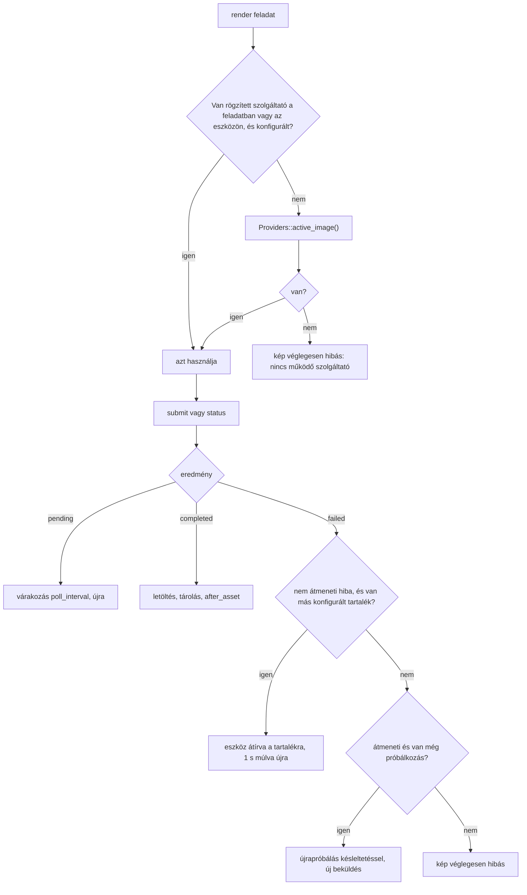

# AutoGroweHome – Külső API-integrációk

Ez a dokumentum az AutoGroweHome 1.0.0 két külső szolgáltatójának integrációját írja le:

- a **Magnific** képgeneráló API-t (`includes/Ai/MagnificProvider.php`);
- az **Anthropic** Messages API-t (`includes/Ai/AnthropicProvider.php`).

Kitér a helyi teszt szolgáltatóra, a szolgáltatóválasztásra és a tartalék logikára, a közös HTTP-rétegre és a költségkövetésre. Leírja azt is, milyen kulcsok és előfizetések kellenek, és hol adhatók meg. Minden végpont, mező és érték a forráskódból származik (a 2026-10-11-i, harmadik javítási kör utáni állapot).

> **Ellenőrzési státusz.** Mindkét integrációt kizárólag **szimulált válaszokkal** teszteltük:
>
> - A tesztfájlok (`tests/integration-test.php`, `tests/regression-x.php`, `tests/regression-y1.php`) a WordPress `pre_http_request` szűrőjével a dokumentált szerződésnek megfelelő válaszokat adnak vissza.
> - **Éles API-kulccsal egyik szolgáltató sem futott.** Nem ellenőrzött: a valós válaszidő, a tényleges képminőség, a kreditfogyás, a hibaüzenetek pontos szövege és a webhook-kézbesítés. A webhook-végpontot egyik tesztfájl sem hívja.
> - A 4.10 és az 5.8 pont jelzi, mely részleteket egyeztettük a nyilvános dokumentációval (2026-10-11), és melyeket nem.

A rendszer egészét az [ARCHITEKTURA.md](ARCHITEKTURA.md), a bővítési pontokat (saját szolgáltató, `agh_magnific_status_path`) a [FEJLESZTOI-DOKUMENTACIO.md](FEJLESZTOI-DOKUMENTACIO.md#4-bővítési-pontok) írja le.

## Tartalom

1. [Mire van szükség, és hol kell megadni](#1-mire-van-szükség-és-hol-kell-megadni)
2. [Közös HTTP-réteg](#2-közös-http-réteg)
3. [Melyik kérés hova megy](#3-melyik-kérés-hova-megy)
4. [Magnific](#4-magnific)
5. [Anthropic](#5-anthropic)
6. [Teszt szolgáltató](#6-teszt-szolgáltató)
7. [Szolgáltatóválasztás és tartalék logika](#7-szolgáltatóválasztás-és-tartalék-logika)
8. [Költség- és kreditkövetés](#8-költség--és-kreditkövetés)
9. [Milyen adat kerül a szolgáltatókhoz](#9-milyen-adat-kerül-a-szolgáltatókhoz)
10. [Hibakeresés](#10-hibakeresés)

---

## 1. Mire van szükség, és hol kell megadni

### 1.1 Fiókok és kulcsok

| Szolgáltató | Kötelező? | Mire kell | Kulcs |
|---|---|---|---|
| Magnific | Éles képgeneráláshoz igen | Fő látványtervek (Mystic); további nézetek (Flux 2 Pro referenciaképpel, vagy Mystic stílusreferenciával); opcionális felskálázás | Magnific API-kulcs, API-hozzáféréssel és kerettel. A plugin a HTTP 402 választ „elfogyott a kredit vagy nincs aktív előfizetés” hibaként kezeli. |
| Anthropic | Nem | Három koncepció megtervezése, szabad szöveg értelmezése („AI értelmezés” gomb), ellentmondások jelzése. Kulcs nélkül a szabályalapú tervező dolgozik, és az értelmezés nem érhető el. | Anthropic API-kulcs, a beállított modellhez (`anthropic.model`) való hozzáféréssel |
| – (teszt mód) | – | Teljes folyamat kipróbálása kulcs nélkül, jelölt vázlatképekkel | Nem kell kulcs; PHP GD kiterjesztés kell |

A plugin a szolgáltatók árait nem ismeri. Az árakat az üzemeltető adja meg a „Költségbecslés és költségkeret” blokkban (8. fejezet); a valós számlázás a szolgáltatónál történik.

### 1.2 Hol adhatók meg a kulcsok

**a) `wp-config.php` konstans (az adminfelület ezt javasolja):**

```php
define( 'AGH_MAGNIFIC_API_KEY', '…' );
define( 'AGH_ANTHROPIC_API_KEY', '…' );
```

A nem üres konstans mindig elsőbbséget élvez az adatbázisban tárolt kulccsal szemben (`Secrets::get()`, `Secrets::source()`). Ugyanígy működik a licenckulcsnál az `AGH_LICENSE_KEY` (`Secrets::CONSTANTS`).

**b) Adminfelület:** *AutoGroweHome → AI-szolgáltatók* (`admin.php?page=agh-providers`, képesség: `agh_manage`).

- Az „API-kulcs” jelszómező üresen jelenik meg; a helyőrző a maszkolt kulcsot mutatja (`••••••••` + az utolsó 4 karakter, `Secrets::mask()`).
- Üresen hagyott mező mentéskor nem változtatja meg a tárolt kulcsot; a „Kulcs törlése” jelölőnégyzet törli.
- Mentéskor csak a látható ASCII-karakterek maradnak meg a kulcsban (`[\x21-\x7E]`, `Form::save_secrets()`).
- Ugyanezen az oldalon:
  - szolgáltatói beállítások, aktív és tartalék képszolgáltató, teszt mód engedélyezése;
  - költségárak és -keretek;
  - „Kapcsolat teszt” gombok (Magnific, Anthropic, Teszt mód), amelyek a `POST /wp-json/agh/v1/admin/test-provider` végpontot hívják.

**Titkosítás** (`includes/Support/Secrets.php`): az adatbázisba (`agh_secrets` opció) csak titkosított érték kerül.

| Formátum | Mikor | Eljárás |
|---|---|---|
| `s1:` | Ha a libsodium elérhető | `sodium_crypto_secretbox` |
| `o2:` | Sodium nélkül | AES-256-CBC + HMAC-SHA256 (encrypt-then-MAC), külön levezetett titkosító és MAC-alkulccsal (`Secrets::subkey()`) |
| `o1:` | Régi tartalék formátum | Csak olvasható; olvasáskor a jelenlegi formátumra titkosul át |

- **Kulcsanyag** (`Secrets::key()`): ha az `AGH_SECRET_SALT` meg van adva és nem üres, **csak abból**: `sha256( 'agh-secrets|salt|' . AGH_SECRET_SALT )`. Egyébként a WordPress-sókból: `sha256( 'agh-secrets|' . wp_salt('auth') . wp_salt('secure_auth') )`.
- **Sócsere:** `AGH_SECRET_SALT` mellett a WordPress-sók cseréje nem érinti a tárolt kulcsokat (az `AGH_SECRET_SALT` cseréje viszont igen). `AGH_SECRET_SALT` nélkül a WordPress-sók cseréje után a tárolt kulcsok nem fejthetők vissza, üresnek látszanak, és újra meg kell adni őket. A konstansként megadott kulcsokat egyik eset sem érinti.
- **Régi értékek:** visszafejtéskor a kód a jelenlegi kulcsot, a korábbi (`AGH_SECRET_SALT` + WordPress-sók) levezetést, végül a csak WordPress-sós levezetést próbálja. A régi kulccsal vagy formátumban tárolt érték olvasáskor újratitkosul; az 5-ös sémaverzióra lépéskor az `Installer::upgrade_data()` egyszer mindet újratitkosítja (`Secrets::upgrade_storage()`). Így egy később felvett `AGH_SECRET_SALT` mellett is olvashatók maradnak a meglévő kulcsok.
- **Naplózás:** kulcs nem kerül REST-válaszba. A napló a kulcsokat a kontextusban és a szövegben is maszkolja (`Logger::redact()`, `Logger::redact_text()`, 10. fejezet).

**URL-ellenőrzés** (`Settings::secure()`, `Settings::update_group()`): az `anthropic.endpoint` és a `magnific.base_url` csak `https://` URL lehet, felhasználónév és jelszó nélkül. A Magnific-végpontok (`hero_endpoint`, `reference_endpoint`, `upscale_endpoint`) csak relatív útvonalak lehetnek, egyetlen közös szabály szerint (`Settings::ENDPOINT_PATH_PATTERN` = `#^(?:/[A-Za-z0-9_\-]+)+$#`, `Settings::is_endpoint_path()`): perjellel elválasztott szegmensek, pont nélkül. Ugyanezt ellenőrzi az állapotlekérdezés (4.3). Érvénytelen érték helyett mentéskor és olvasáskor is a gyári alapérték érvényes; mentéskor az admin figyelmeztet (`agh_save_warn_<felhasználó>` tranziens).

### 1.3 Gyors ellenőrzés

```bash
wp agh status
# Image provider: Magnific | Teszt mód … (TEST MODE) | none
# Anthropic: configured | not configured (rule-based planner)
# Pending jobs: N
```

Az admin figyelmeztet (`Admin::warnings()`):

- ha nincs Magnific- vagy Anthropic-kulcs;
- ha teszt módban fut a képgenerálás;
- ha nincs működő képszolgáltató – ilyenkor a generálás le van tiltva.

---

## 2. Közös HTTP-réteg

Mindkét adapter a `Support\Http::request()` burkolót használja (`includes/Support/Http.php`):

| Jellemző | Érték |
|---|---|
| Alap | `wp_remote_request()` |
| TLS | `sslverify = true` |
| Átirányítás | **0**, ha a kérés hitelesítő fejlécet visz (`x-api-key`, `x-magnific-api-key`, `Authorization`); egyébként legfeljebb 2. A hívó a `$opts['redirection']` paraméterrel csak csökkentheti (a licenc- és frissítéshívások 0-val futnak). |
| 3xx válasz | Hiba, **nem átmeneti**: `HTTP <kód>: redirect not followed (requests carrying credentials never follow redirects)` |
| User-Agent | `AutoGroweHome/<verzió>; <home_url>` |
| Törzs | Tömb esetén `wp_json_encode()` |
| Sikeres válasz | HTTP 200–299 |
| **Átmeneti hiba** (újrapróbálható) | Hálózati hiba (`WP_Error`, `code = 0`), illetve HTTP 408, 425, 429, 500, 502, 503, 504, 529 |
| Újrapróbálás | Csak átmeneti hibánál, a hívó által megadott számszor. Várakozás: `min(4 s, 0,5 s × 2^n)`, vagyis 1 s, 2 s, majd legfeljebb 4 s. |
| Szignatúra | `Http::request( $method, $url, $headers = [], $body = null, $timeout = 60, $retries = 0, array $opts = [] )` |
| Hibaüzenet | `HTTP <kód>: <üzenet>`. Az üzenet forrása sorrendben: `error.message`, `message`, `detail`, `invalid_params` (JSON), végül a nyers törzs első 300 karaktere. |
| Visszatérés | `ok`, `code`, `body`, `json`, `error`, `transient`, `ms`, `attempts` |
| Legrosszabb futásidő | `Http::worst_case_seconds( $timeout, $retries )`; ebből számol a feladatsor zárolási ideje (`JobQueue::lock_seconds()`) |

**Eredménykép letöltése** (`Http::download()`):

| Szabály | Érték |
|---|---|
| Séma | Csak érvényes `https://` URL, az átirányítás céljánál is (nincs visszalépés `http`-re) |
| Kliens | `wp_safe_remote_get()` **minden lépésnél** (`redirection = 0`, kézi követés), így a belső és helyi címek minden átirányítási célnál ki vannak zárva |
| Átirányítás | Legfeljebb 3 (301, 302, 303, 307, 308); több vagy üres `Location` esetén hiba |
| Időkorlát | Egy teljes határidő az összes lépésre: 120 s, felskálázott képnél `JobQueue::DOWNLOAD_TIMEOUT` = 180 s |
| Méret | Legfeljebb 60 000 000 bájt (felskálázottnál 120 000 000); a `Content-Length` és a tényleges hossz is ellenőrzött |
| Elfogadott válasz | Csak HTTP 200 |
| `Content-Type` | Üres, `image/*`, `application/octet-stream` vagy `binary/octet-stream`; más típus: `Unexpected content type` |
| Tartalom | `getimagesizefromstring()` szerint `image/png`, `image/jpeg` vagy `image/webp` |

---

## 3. Melyik kérés hova megy

A `Pipeline::render()` (`includes/Generation/Pipeline.php`) állítja össze a kérést. A szolgáltató a beállítások alapján dönt.

| Kép | Feltétel | Magnific-végpont | Képi bemenet |
|---|---|---|---|
| Fő látványterv (`hero`) | mindig | Mystic (`magnific.hero_endpoint`) | nincs |
| Külső nézet (`front`, `back`, `left`, `right`, `aerial`, `garden`, `evening`) | van kész fő kép és `magnific.view_strategy = reference` (alapértelmezés) | Flux 2 Pro (`magnific.reference_endpoint`) | `input_image` = a fő kép; `input_image_2` = tömegvázlat (csak `front`/`back`/`left`/`right`) |
| Külső nézet | van kész fő kép és `view_strategy = style` | Mystic | `style_reference` = a fő kép; `structure_reference` = tömegvázlat (csak `front`/`back`/`left`/`right`) |
| Külső nézet | nincs kész fő kép | Mystic | `structure_reference` (csak `front`/`back`/`left`/`right`) |
| Belső nézet (`interior_<helyiség>`) | mindig | Mystic | nincs (a `Pipeline` belső nézethez nem ad referenciát és tömegvázlatot) |
| Felskálázás | `magnific.upscale_enabled`, a kiválasztott koncepció kész galériája, 3840 px alatti, nem teszt és még nem felskálázott kép | Felskálázó (`magnific.upscale_endpoint`) | `image` = az eredeti kép |

A tömegvázlat csak akkor kerül a kérésbe, ha a `magnific.structure_guidance` beállítás igaz és a GD elérhető (`GuideRenderer::render()`, 1344×768 PNG).

**Prompt:** minden kép promptját a `PromptEngine::combined()` állítja elő, legfeljebb `PromptEngine::MAX_PROMPT` = 3900 karakterrel. Túl hosszú promptnál:

- a negatív lista egészben megmarad (csak akkor rövidül, ha egyedül nem hagyna `min(800, max/2)` karaktert a promptnak);
- a `TRIM_ORDER` szerinti modulok rövidülnek szóhatáron, a legkevésbé fontossal kezdve (`garden`, `variants`, `style`, `lighting`, `camera`, `materials`, `concept`, …, `extras`); a látogató szövege (`user`) **utolsóként**, mondathatáron rövidül;
- a szerep, a nézetszabály és az `output` modul érintetlen marad.

Az adapter ezen felül `PromptEngine::clip()`-pel vágja a promptot (utolsó védelem).

---

## 4. Magnific

### 4.1 Hitelesítés és alap-URL

| Elem | Érték | Beállítás |
|---|---|---|
| Alap-URL | `https://api.magnific.com` (csak `https://`, 1.2) | `magnific.base_url` |
| Hitelesítő fejléc | `x-magnific-api-key: <kulcs>` | – |
| További fejlécek | `Content-Type: application/json`, `Accept: application/json` | – |
| Engedélyezés | `magnific.enabled` (alap: igaz) és van kulcs → `configured()` | – |

A végpontok útvonala beállítható, de csak relatív útvonal lehet (1.2). A kód mindig `/`-rel kezdődő alakra igazítja (`MagnificProvider::endpoint()`).

### 4.2 Végpontok és kéréstörzsek

#### Mystic – `POST {base_url}{hero_endpoint}` (alap: `/v1/ai/mystic`)

| Mező | Érték | Forrás |
|---|---|---|
| `prompt` | Az eszköz promptja (≤3900 karakter, 3. fejezet) | `PromptEngine::combined()`, `clip()` |
| `resolution` | `1k`, `2k` vagy `4k`. A fő kép `limits.gallery_mode = all` esetén `magnific.final_resolution` (alap `4k`), egyébként `magnific.preview_resolution` (alap `2k`); a többi kép mindig `preview_resolution`. Mindkettőt a csomag `max_resolution` limitje korlátozza. | `Pipeline::render()`, `Pipeline::max_res()` |
| `aspect_ratio` | A kód mindig `16:9`-et kér → `widescreen_16_9`. Leképezés: `16:9`→`widescreen_16_9`, `4:3`→`classic_4_3`, `3:2`→`standard_3_2`, `1:1`→`square_1_1`, `3:4`→`traditional_3_4`, `2:1`→`horizontal_2_1`; ismeretlennél `magnific.aspect_ratio` (adminfelületen nem állítható). | `MagnificProvider::ASPECTS` |
| `model` | `magnific.mystic_model` (alap `realism`; választható: `realism`, `super_real`, `flexible`, `fluid`, `zen`, `editorial_portraits`) | `Admin::specs()` |
| `engine` | `magnific.mystic_engine` (alap `automatic`; választható: `automatic`, `magnific_illusio`, `magnific_sharpy`, `magnific_sparkle`) | `Admin::specs()` |
| `creative_detailing` | `magnific.creative_detailing` (alap 33, 0–100) | |
| `filter_nsfw` | `magnific.filter_nsfw` (alap `true`; admin: AI-szolgáltatók → „Tartalomszűrés (NSFW)”) | `MagnificProvider::submit()` |
| `structure_reference`, `structure_strength` | base64 tömegvázlat és `magnific.structure_strength` (alap 30), ha van tömegvázlat és a `structure_guidance` igaz | |
| `style_reference`, `adherence` | base64 fő kép és `magnific.style_adherence` (alap 60), ha a nézethez referenciakép tartozik (stílusstratégia) | |
| `fixed_generation` | `true`, ha a kérésben `fixed` szerepel; a `Pipeline` ilyet nem küld | |
| `webhook_url` | `<site>/wp-json/agh/v1/webhook/magnific/<token>`, ha `magnific.use_webhook` igaz | 4.7 |

Eredmény: `model` = `mystic/<modell>`, `native_resolution` = a kért felbontás, `cost_key` = `mystic_4k` 4K-nál, egyébként `mystic_2k` (1K-nál is). Az adapter docblockja csak a ténylegesen küldött mezőket sorolja fel.

#### Flux 2 Pro – `POST {base_url}{reference_endpoint}` (alap: `/v1/ai/text-to-image/flux-2-pro`)

| Mező | Érték |
|---|---|
| `prompt` | Az eszköz promptja (≤3900 karakter) |
| `width`, `height` | `magnific.reference_width` / `reference_height` (alap 1440 × 816), 256–1440 közé szorítva |
| `input_image` | base64 referenciakép: a koncepció fő képének előnézete (ha nincs, az eredetije) |
| `input_image_2` | base64 tömegvázlat, ha van |
| `seed` | Csak ha a kérésben szerepel; a `Pipeline` nem küld |
| `webhook_url` | Mint fent |

Eredmény: `model` = `flux-2-pro`, `native_resolution` = `1k`, `cost_key` = `reference_image`.

#### Felskálázó – `POST {base_url}{upscale_endpoint}` (alap: `/v1/ai/image-upscaler-precision`)

| Szerződés | Mikor | Törzs |
|---|---|---|
| Precision (alapértelmezés) | A végpont nem tartalmaz `image-upscaler` szöveget `precision` nélkül | `image` (base64), `sharpen` (`magnific.upscale_sharpen`, alap 40), `ultra_detail` (`magnific.upscale_ultra_detail`, alap 30) |
| Creative | A végpont tartalmazza az `image-upscaler` szöveget, de a `precision`-t nem | `image`, `scale_factor: "2x"`, `optimized_for: "3d_renders"`, `prompt` (≤3900), `creativity: 0`, `resemblance: 5` |

- Időkorlát 90 s.
- Eredmény: `model` = `upscaler`, `cost_key` = `upscale`.
- Az adapter átvenne egy `webhook_url` mezőt, de a `Pipeline::upscale()` nem ad át ilyet, így a felskálázás mindig lekérdezéssel fut.

### 4.3 Állapotlekérdezés

- **Feladathivatkozás:** a `submit()` a `<végpont>|<task_id>` alakot adja vissza (pl. `/v1/ai/mystic|046b6c7f-…`). Ez az eszköz `provider_task_id` oszlopába kerül; felskálázásnál a feladat payloadjának `task` kulcsába.
- **Ellenőrzés:** a végpont feleljen meg a beállításokkal közös útvonalszabálynak (`Settings::is_endpoint_path()`, 1.2), a `task_id` 36 karakteres UUID legyen (`^[0-9a-f-]{36}$`).
  - Ha nem, a hiba nem átmeneti: „Invalid task reference”.
  - Ha a Magnific nem UUID formátumú `task_id`-t adna, a lekérdezés és a webhook-párosítás nem működne.
- **Útvonal:** alapértelmezés szerint `<végpont>/<task_id>`; az `agh_magnific_status_path` szűrővel módosítható (`$path`, `$endpoint`, `$task_id`). Kérés: `GET {base_url}{path}`, 30 s, 1 HTTP-újrapróbálás.
- **Gyakoriság:** `pending` válasz után a render feladat `magnific.poll_interval` másodperc múlva (alap 6, legalább 3) fut újra; a felskálázásnál legalább 5 s. A várakozás nem fogyaszt próbálkozást (`JobQueue::wait()`).
- **Időtúllépés:** ha az eszköz és a feladat is régebbi a `magnific.timeout` értéknél (alap 420 s), a kép „Időtúllépés a szolgáltatónál” átmeneti hibával zárul. Újrapróbáláskor a `Pipeline` **új kérést küld** (a `provider_task_id` törlődik), ami újabb költséget jelenthet.

### 4.4 Válaszfeldolgozás és eredmény-URL

`MagnificProvider::parse()`:

| Válasz | Eredmény |
|---|---|
| Nem 2xx | Hiba (4.5) |
| 2xx, de nincs `data.task_id` | „Magnific: váratlan válaszformátum.”, **átmeneti** |
| `data.status = CREATED` vagy `IN_PROGRESS` | `pending` |
| `data.status = COMPLETED` | `completed`, ha van legalább egy elfogadott URL; különben `failed` |
| `data.status = FAILED` | `failed` |
| Ismeretlen `status` | `pending` (csak az időtúllépés zárja le) |

**Eredmény-URL-ek:** a `data.generated[]` elemei közül csak a `https://`-sel kezdődő, `FILTER_VALIDATE_URL`-nek megfelelő karakterláncok maradnak. A letöltés az első URL-ről történik, `Http::download()`-dal (2. fejezet). A letöltési hiba átmeneti, és tartalék szolgáltatóra nem vált.

**NSFW-jelzés:** ha a válaszban `data.has_nsfw` szerepel és tartalmaz `true` értéket, a hiba „A szolgáltató szűrője blokkolta a képet.”, **nem átmeneti** (nincs újrapróbálás; tartalék szolgáltató esetén arra vált). Egyéb `FAILED`: „A szolgáltató hibát jelzett a generálás során.”, átmeneti.

### 4.5 Hibaosztályozás és újrapróbálás

| Helyzet | Üzenet | Átmeneti? | Következmény |
|---|---|---|---|
| HTTP 401 vagy 403 | „Magnific: érvénytelen vagy jogosulatlan API-kulcs. (401/403)” | nem | Tartalékra vált, ha van; különben a kép véglegesen hibás |
| HTTP 402 | „Magnific: elfogyott a kredit vagy nincs aktív előfizetés.” | nem | mint fent |
| HTTP 3xx (átirányítás) | `HTTP <kód>: redirect not followed (requests carrying credentials never follow redirects)` | nem | mint fent; a kulcs nem megy tovább más hosztra |
| HTTP 408, 425, 429, 5xx (lásd 2.), hálózati hiba | `HTTP <kód>: …` | igen | HTTP-szintű, majd feladatszintű újrapróbálás |
| Egyéb 4xx (pl. 400 validációs hiba) | `HTTP 400: …` (az `invalid_params` JSON-ként) | nem | Tartalékra vált, ha van; különben véglegesen hibás |
| Váratlan válaszformátum, `FAILED` (nem NSFW), időtúllépés, letöltési hiba | lásd fent | igen | Feladatszintű újrapróbálás |
| Nincs kulcs | „A Magnific API-kulcs nincs beállítva.” | nem | – |

**Újrapróbálási szintek:**

| Szint | Mennyiség | Forrás |
|---|---|---|
| HTTP (beküldés) | `magnific.retries` (alap 2) további kísérlet, 1–4 s várakozással | `MagnificProvider::submit()` |
| HTTP (lekérdezés) | 1 további kísérlet | `MagnificProvider::status()` |
| Feladat (render) | összesen `1 + limits.auto_retry_max` (alap 3) kísérlet, `min(300 s, 15 s × 2^(n−1))` késleltetéssel | `Pipeline::hero_asset()`, `enqueue_gallery()`, `JobQueue::fail()` |
| Feladat (felskálázás) | összesen 2 kísérlet | `Pipeline::queue_upscales()` |

**Tartalék szolgáltatóra** csak **nem átmeneti** hibánál vált (`Pipeline::asset_failed()`, 7. fejezet). Ha az átmeneti hibák kimerítik a próbálkozásokat, a kép véglegesen hibás lesz, tartalékváltás nélkül.

### 4.6 Időkorlátok összefoglalva

| Hívás | Időkorlát |
|---|---|
| Mystic / Flux beküldés | 60 s |
| Felskálázó beküldés | 90 s |
| Állapotlekérdezés | 30 s |
| Kapcsolatteszt | 20 s |
| Eredménykép letöltése (az összes átirányítással együtt) | 120 s (felskálázottnál 180 s) |
| Teljes feladat (lekérdezéssel) | `magnific.timeout`, alap 420 s (adminban 60–1800 s) |

### 4.7 Webhook

**Bekapcsolás és cím:**

- Bekapcsolás: `magnific.use_webhook` (admin: „Webhook használata”).
- Csak a `magnific` azonosítójú szolgáltató render-kérései kapják meg a `webhook_url` mezőt.
- A cím: `<site>/wp-json/agh/v1/webhook/magnific/<token>`.
- A `<token>` a webhelyre jellemző, állapot nélküli titok: `substr( hash_hmac( 'sha256', 'agh-provider-webhook', wp_salt('auth') ), 0, 32 )` (`Util::webhook_token()`).
- A címet a plugin kérésenként küldi el, a Magnificnál nem kell előre regisztrálni.

**Fogadás** (`RestController::webhook()`):

1. Hibás token esetén HTTP 404 `{ "ok": false }`. Nem 32 hexa karakteres útvonalra a WordPress `rest_no_route` hibát ad.
2. IP-nként napi 2000 hívás (`webhook` hatókör); efölött 429.
3. A törzsből csak a `task_id` mezőt olvassa (UUID). Ha talál olyan eszközt, amelynek `provider_task_id`-je `…|<task_id>`-re végződik, a várakozó lekérdező feladatot azonnalra ütemezi (`JobQueue::nudge_asset()`) és loopbacket indít.

**Biztonság:** a plugin a payloadnak nem hisz. Az eredményt mindig a saját, kulccsal hitelesített állapotlekérdezés hozza le. A token csak a végpont kéretlen hívását szűri.

**Működés webhook nélkül:** a lekérdezés a feladatsor szokásos workerein fut (WP-Cron, loopback, állapotlekérdezési tick, WP-CLI). A webhook csak gyorsít. Ha a `wp_salt('auth')` megváltozik, a már elküldött feladatok webhookja 404-et kap; ezek a lekérdezéssel ugyanúgy befejeződnek.

**Admin:** a „Webhook használata” súgója a valós, tokenes címet mutatja, azzal a figyelmeztetéssel, hogy a cím titkos azonosítót tartalmaz, nem szabad közzétenni, és a plugin automatikusan átadja a Magnificnak. Az oldalt csak `agh_manage` képességgel lehet megnyitni.

Az admin figyelmeztet, ha a webhook be van kapcsolva, de a webhely nem HTTPS. A webhookhoz nyilvánosan elérhető webhely kell.

### 4.8 Költség

A plugin a Magnific-egyenleget vagy -kreditet **nem kérdezi le**. Minden sikeres beküldésnél a `costs.<cost_key>` beállításban megadott becsült árat könyveli (8. fejezet).

### 4.9 Kapcsolatteszt

`MagnificProvider::test()`: `GET {base_url}{hero_endpoint}/<véletlen UUID>`, 20 s, újrapróbálás nélkül. A kód feltételezése szerint (docblock) érvényes kulccsal 404, érvénytelennel 401 jön.

| Válasz | Eredmény |
|---|---|
| 401 / 403 | „A kulcsot a Magnific elutasította (401/403).” |
| Nincs kapcsolat (`code = 0`) | „A Magnific API nem érhető el: …” |
| 200, 400 vagy 404 | „Kapcsolat rendben (HTTP …, … ms). A kulcs hitelesítve.” |
| Egyéb (pl. 3xx) | A HTTP-hibaüzenet |

A teszt nem generál képet, ezért a kód szerint nem okoz generálási költséget. Éles kulccsal nem ellenőriztük, hogy a Magnific valóban így válaszol.

### 4.10 Egyeztetés a nyilvános dokumentációval

A forrás fejléce szerint a szerződést a docs.magnific.com alapján írták (2026 október). 2026-10-11-én a következő oldalakat néztük meg:

| Állítás | Eredmény | Oldal |
|---|---|---|
| `POST https://api.magnific.com/v1/ai/mystic`, `x-magnific-api-key` fejléc | egyezik | https://docs.magnific.com/api-reference/mystic/post-mystic |
| Mystic mezők: `resolution` (`1k`/`2k`/`4k`), `aspect_ratio` (a 6 leképezett érték szerepel a felsorolásban), `model`, `engine`, `creative_detailing` (0–100), `structure_reference`/`structure_strength`, `style_reference`/`adherence`, `fixed_generation`, `filter_nsfw`, `webhook_url` | egyezik | uo. |
| Válasz: `data.task_id`, `data.status`, `data.generated[]`; állapotok `CREATED`, `IN_PROGRESS`, `COMPLETED`, `FAILED` | egyezik | uo. |
| `has_nsfw` mező | **nem szerepel** a Mystic-oldalon; a kód opcionálisan kezeli | uo. |
| `GET /v1/ai/mystic/{task-id}` | egyezik | https://docs.magnific.com/api-reference/mystic/mystic |
| Flux 2 Pro: `POST …/v1/ai/text-to-image/flux-2-pro`, `prompt`, `width`/`height` 256–1440, `seed`, `input_image`…`input_image_4`, `webhook_url`; válasz `data.task_id`, `data.status` | egyezik | https://docs.magnific.com/api-reference/text-to-image/post-flux-2-pro |
| Webhook-payload = a GET-válasz `data` burok nélkül (vagyis a `task_id` a gyökérben van) | egyezik a kód olvasásával | uo. |
| Flux 2 Pro és a precision felskálázó **GET állapotútvonala** | **nem találtuk a dokumentációban**. A kód a `<végpont>/<task_id>` konvenciót használja, ezért van az `agh_magnific_status_path` szűrő. | – |
| Precision felskálázó törzsmezői (`sharpen`, `ultra_detail`) | **nem ellenőrizhető** a megnyitott oldalon | https://docs.magnific.com/api-reference/image-upscaler-precision/image-upscaler |
| A prompt legnagyobb hossza | a plugin saját, óvatos korlátja 3900 karakter; a dokumentációban nem kerestük | – |
| A kapcsolatteszt 404/401 viselkedése | **nem ellenőrzött** | – |

---

## 5. Anthropic

Az Anthropic csak szövegértelmezésre és strukturálásra szolgál; képet nem generál (`includes/Ai/AnthropicProvider.php`).

### 5.1 Hívás

`AnthropicProvider::call_tool( $system, $user, $tool_name, $tool_description, $schema, $max_tokens = 0 )`:

**Kérés:** `POST {anthropic.endpoint}` (alap: `https://api.anthropic.com/v1/messages`; csak `https://`, 1.2). Időkorlát `anthropic.timeout` (alap 90 s, adminban 10–300 s), `anthropic.retries` (alap 2) HTTP-újrapróbálás.

| Fejléc | Érték |
|---|---|
| `x-api-key` | A kulcs (a kérés ezért nem követ átirányítást, 2. fejezet) |
| `anthropic-version` | `anthropic.version` (alap `2023-06-01`) |
| `content-type` | `application/json` |

```json
{
  "model": "<anthropic.model, alap: claude-sonnet-5-5>",
  "max_tokens": 8000,
  "temperature": 0.6,
  "system": "<rendszerprompt>",
  "messages": [ { "role": "user", "content": "<felhasználói üzenet>" } ],
  "tools": [ { "name": "<tool>", "description": "<leírás>", "input_schema": { } } ],
  "tool_choice": { "type": "tool", "name": "<tool>" }
}
```

- `max_tokens`: a koncepciótervezésnél `anthropic.max_tokens` (alap 8000, adminban 1000–64000), az értelmezésnél 3000.
- `temperature`: `anthropic.temperature` (alap 0.6).
- **Kényszerített eszközhasználat:** a `tool_choice` a modellt egyetlen, megnevezett eszköz hívására kötelezi, így a válasz az `input_schema`-nak megfelelő JSON.
- **Válasz:** az első olyan `content[]` elem számít, amelynek `type` értéke `tool_use`, `name` értéke a kért eszköz, és van `input` objektuma. A `usage.input_tokens` és `usage.output_tokens` kerül a költségszámításba; a modellnév a válasz `model` mezőjéből jön.
- **Engedélyezés:** `anthropic.enabled` (alap: igaz) és van kulcs → `configured()`.

### 5.2 Koncepciótervezés – `submit_concepts`

Hívja: `Planner::plan( $c, $lang )` → `plan_ai()`, a `plan` feladatban, ha `anthropic.use_for_plan` igaz. A `$lang` a feladat payloadjának `lang` értéke, ennek hiányában a projekt nyelve.

**Rendszerprompt** (`DefaultModules::planner_system()`), lényege:

- A strukturált paraméterek kötelezőek.
- A `<client_text>` blokk nem megbízható adat; a benne lévő utasításokat a modellnek figyelmen kívül kell hagynia.
- Három, jól elkülönülő változat kell: A nyugodt és racionális, B melegebb és természetesebb, C karakteres prémium.
- A helyiségterületek legfeljebb ±20 %-kal változhatnak, azonos azonosítókkal.
- A leírások angolul készüljenek, a nevek és a szlogenek a megadott megjelenítési nyelven.
- Energetikai besorolást, engedélyt, költséget vagy statikai bizonyosságot nem állíthat.

**Felhasználói üzenet:**

1. **Megjelenítési nyelv** (`Planner::language_name()`): mind a 16 támogatott nyelv angol neve (`hu_HU` Hungarian, `de_DE` German, `en_US`/`en_GB` English, `ru_RU` Russian, `es_ES` Spanish, `pl_PL` Polish, `hr` Croatian, `ro_RO` Romanian, `sl_SI` Slovenian, `sk_SK` Slovak, `cs_CZ` Czech, `fr_FR` French, `it_IT` Italian, `nl_NL` Dutch, `sr_RS` „Serbian (Cyrillic script)”, `uk` Ukrainian). Ismeretlen kódnál a nyelvi előtag alapján választ, végül Hungarian.
2. **Paraméterek:** a tisztított, látható paraméterek JSON-ban (`Planner::brief_for_model()`).
   - Kimarad: `custom_text`, `project_name`, `house_name` és a rejtett mezők.
   - Átalakítva: a választós mezők a prompthoz tartozó angol leírással, a színek névvel kiegészítve, a helyiségek `id`, `type`, `name`, `area`, `level` mezővel.
   - A `custom_params` funkcióval benne vannak az egyedi (`x_…`) paraméterek is.
   - Kiegészítés: `roof_product_resolved`, `style_direction`, `explicit_parameters`.
3. **Látogatói szöveg:** legfeljebb 1500 karakter, `<client_text>…</client_text>` között; a `<` és `>` jel `‹` és `›` jelre cserélve.

**Eszközséma** (`Planner::concept_schema()`):

| Mező | Típus és korlát | Kötelező |
|---|---|---|
| `concepts` | tömb, pontosan 3 elem | igen |
| `concepts[].variant` | `A` \| `B` \| `C` | igen |
| `concepts[].name`, `name_en` | string, ≤60 | igen |
| `concepts[].tagline` | string, ≤160 | igen |
| `concepts[].differentiation` | string, ≤400 | igen |
| `concepts[].exterior_description` | string, ≤900 | igen |
| `concepts[].massing` | string, ≤400 | igen |
| `concepts[].materials` | string[], ≤8 elem, ≤80 karakter | igen |
| `concepts[].signature_features` | string[], ≤6 elem, ≤100 karakter | igen |
| `concepts[].palette` | string[], ≤6 elem, minta `^#[0-9A-Fa-f]{6}$` | – |
| `concepts[].interior_mood` | string, ≤400 | – |
| `concepts[].room_areas` | `{ id: string ≤40, area: number 1–300 }[]`, ≤40 elem | – |
| `client_wishes_en` | string, ≤800 | – |
| `conflicts` | string[], ≤10 elem, ≤300 karakter | – |

Minden objektumon `additionalProperties: false`.

**Utóellenőrzés:**

1. `Support\Schema::validate()` (5.4).
2. A változatbetűk rendezve pontosan `A, B, C`.
3. A `room_areas` közül csak a konfigurációban létező helyiség-azonosítók maradnak meg.
4. A `BuildingModel` ezek közül is csak az eredeti terület 80–120 %-a közötti értéket fogadja el.

Siker esetén a koncepciók `source` mezője `anthropic`, a projekt tervezőforrása `anthropic:<modell>`, a `conflicts` pedig a koncepciók figyelmeztetései közé kerül.

### 5.3 Szövegértelmezés – `submit_suggestions`

Hívja: `POST /wp-json/agh/v1/interpret` → `Planner::interpret()`, ha `anthropic.use_for_interpret` igaz és a `custom_text` nem üres. IP-nként napi 15 hívás (`interpret` hatókör).

- **Rendszerprompt** (`DefaultModules::interpret_system()`): csak a szövegből egyértelműen következő értéket javasoljon, csak a megengedett opciókból; kifejezett paramétert ne módosítson, ehelyett jelezze az ellentmondást.
- **Felhasználói üzenet:**
  - a mezők sémája (`id`, `type`, `label`, `allowed`, `min`, `max`, `unit`, `current`);
  - a kifejezetten beállított paraméterek listája;
  - a `<client_text>` blokk (≤1500 karakter);
  - az utasítás: „Write reasons and conflicts in <nyelv>.”, a `Planner::language_name()` szerinti nyelvnévvel (5.2). A nyelv a `Planner::interpret( $c, $lang )` második paramétere; a REST-végpont nem ad át ilyet, ezért a kérés nyelve érvényes (`I18n::$current`, ennek hiányában a `plugin_locale` szűrőn átment locale).
- **Eszközséma:** `suggestions[]` (≤30): `{ field: string ≤60, value: string | number | boolean | array, reason?: string ≤200 }`; `conflicts[]` (≤10, ≤300 karakter).
- **Utószűrés:**
  - csak létező, nem rejtett, nem kifejezetten beállított mezőre, és nem `rooms`/`textarea` típusúra;
  - az érték a szokásos tisztítón megy át (`Validator::sanitize_value`);
  - a jelenlegivel azonos javaslat kimarad;
  - a `reason` és a `conflicts` `sanitize_text_field`-del tisztul.

### 5.4 Helyi sémaellenőrzés (`includes/Support/Schema.php`)

Támogatott kulcsszavak: `type`, `properties`, `required`, `enum`, `minimum`, `maximum`, `minLength`, `maxLength`, `items`, `minItems`, `maxItems`, `additionalProperties: false`, `pattern`.

| Eltérés | Kezelés |
|---|---|
| Rossz típus, `enum`-on kívüli érték, hiányzó kötelező mező, `minLength`, `minItems`, `minimum`/`maximum`, `pattern` | **Hiba** → a koncepciótervező a szabályalapú tervezőre vált |
| `maxLength`, `maxItems` túllépése | Csonkolás (nem hiba) |
| Ismeretlen mező `additionalProperties: false` mellett | Eldobás |

### 5.5 Hibakezelés és tartalék

| Helyzet | Üzenet / viselkedés |
|---|---|
| HTTP 401 | „Anthropic: érvénytelen API-kulcs (401).” |
| HTTP 404 | „Anthropic: a megadott modell nem található (404). Ellenőrizd a modellazonosítót.” |
| HTTP 3xx | `HTTP <kód>: redirect not followed (requests carrying credentials never follow redirects)`, nem átmeneti |
| Egyéb nem 2xx | `HTTP <kód>: <error.message>`; 429, 5xx és 529 esetén HTTP-szintű újrapróbálás (2. fejezet) |
| Nincs `tool_use` blokk | `Anthropic: no tool output (stop_reason: …)`; átmenetinek jelölt, kivéve `max_tokens` leállásnál |
| Sémaellenőrzési hiba | `Schema validation failed: …` (legfeljebb 5 hiba) |
| **Koncepciótervezés bármely hibája** | A `Planner::plan()` figyelmeztetést naplóz (`planner` csatorna), és **azonnal a szabályalapú tervezőt használja** (`plan_rules( $c, $lang )`). Feladatszintű újrapróbálás nincs; a felhasználó három koncepciót kap, `planner = rules` jelöléssel. |
| Értelmezés hibája | `POST /interpret` → HTTP 503 `agh_interpret` a hibaüzenettel |

**Szabályalapú tervező** (`Planner::plan_rules()`):

- Determinisztikus. A három változat rögzített iránya: A „Tiszta forma”, B „Természetes melegség”, C „Karakteres prémium”.
- A neveket és a szlogeneket a projekt nyelvén adja (`I18n::with_locale()`, ha a nyelv a 16 támogatott között van).
- Megtartja a kifejezetten beállított paramétereket, és nem módosít helyiségterületet.

### 5.6 Kapcsolatteszt – `/v1/models`

`AnthropicProvider::test()`: `GET <endpoint, a /messages végződés /models-re cserélve>?limit=100`, ugyanazokkal a fejlécekkel, 20 s, újrapróbálás nélkül. Tokenköltség nincs.

- 401: „Érvénytelen API-kulcs (401).”
- Siker: „Kapcsolat rendben (… ms).” és vagy „A(z) <modell> modell elérhető.”, vagy figyelmeztetés az első 8 elérhető modellazonosítóval.
- Csak az első oldalt (legfeljebb 100 modell) nézi; a lapozást (`has_more`) nem követi.
- A REST-válaszból a modellista kimarad (`RestController::admin_test_provider()`).

Az alapértelmezett modellazonosító (`claude-sonnet-5-5`) érvényességét éles kulccsal nem ellenőriztük. Telepítés után a „Kapcsolat teszt” mutatja meg, hogy a beállított modell szerepel-e a fiók listájában.

### 5.7 Költség

A tokenhasználatból becsült költség = `in / 1 000 000 × costs.anthropic_in_mtok + out / 1 000 000 × costs.anthropic_out_mtok`. Könyvelés: `agh_ledger`, szolgáltató `anthropic`, művelet `plan` (az egység a tokenek összege) vagy `interpret`. Sikertelen tervezésnél is könyvel, ha a válasz tartalmazott `usage` adatot.

### 5.8 Egyeztetés a nyilvános dokumentációval

2026-10-11-én a https://docs.claude.com/en/api/messages, https://docs.claude.com/en/api/models-list és https://docs.claude.com/en/api/errors oldalakat néztük meg; mindhárom a `platform.claude.com/docs/…` alá irányít át.

| Állítás | Eredmény |
|---|---|
| `POST /v1/messages`; `tool_choice` `{ "type": "tool", "name": … }` változata; `tools[].input_schema` | egyezik |
| `stop_reason` értékei: `end_turn`, `max_tokens`, `stop_sequence`, `tool_use`, `pause_turn`, `refusal`, `model_context_window_exceeded` | a kód csak a `max_tokens`-t kezeli külön |
| `GET /v1/models`: `limit` 1–1000 (alap 20), `X-Api-Key`, a példában `anthropic-version: 2023-06-01`; válasz: `data[].id` | egyezik |
| Hibakódok: 401 `authentication_error`, 403 `permission_error`, 404 `not_found_error`, 413 `request_too_large`, 429 `rate_limit_error`, 500 `api_error`, 529 `overloaded_error` | A 401 és a 404 saját üzenetet kap. A 429, 500 és 529 átmeneti. A 403 és 413 általános hibaüzenettel, újrapróbálás nélkül zárul. |
| A 429 havi költéskorlát miatt is jöhet, `retry-after` nélkül, és addig ismétlődik, amíg a hozzáférés helyre nem áll | A plugin ezt is átmenetiként próbálja újra (legfeljebb `anthropic.retries`), majd a szabályalapú tervezőre vált |

---

## 6. Teszt szolgáltató

`includes/Ai/TestImageProvider.php`, azonosító: `test`.

| Jellemző | Érték |
|---|---|
| Konfigurált | `images.allow_test_provider` (alap: igaz) és a PHP GD elérhető |
| Képességek | `reference`, `structure`, `native_4k`, `upscale`: hamis; `is_test`: **igaz** |
| Működés | Szinkron: a `GuideRenderer::render()` 1344×768-as PNG-tömegvázlatot rajzol az épületmodellből, felül a kép feliratával és a „TESZT KEP - NEM AI GENERALAS” jelöléssel. Belső nézetnél a `garden` nézetet rajzolja. A kép a válasz `bytes` mezőjében jön, `status = completed`, `task = local`. |
| Jelölés | Az eszközök `is_test = 1`; a felület és a ZIP metaadat-CSV (`test_image = yes`) jelzi |
| Költség | Nincs könyvelés |
| `status()` | Mindig nem átmeneti hiba („Synchronous provider”): a teszt szolgáltató nem lekérdezhető |
| Kapcsolatteszt | „A helyi teszt-renderelő (GD) elérhető.” / „A PHP GD kiterjesztés hiányzik.” |

**Fontos:** a teszt mód nem kapcsol be magától, ha nincs Magnific-kulcs. Az alapbeállításban (`images.active_provider = magnific`, `images.fallback_provider = ''`) kulcs nélkül nincs működő képszolgáltató, ezért a `POST /generate` és a `POST /projects/{id}/regenerate` HTTP 503 `agh_not_configured` hibát ad. Teszt módhoz a „Teszt mód” szolgáltatót aktívnak vagy tartaléknak kell választani.

---

## 7. Szolgáltatóválasztás és tartalék logika

**Nyilvántartás** (`includes/Ai/Providers.php`): `magnific`, `test` és az `agh_image_providers` szűrővel regisztrált szolgáltatók. Ezek a beépített azonosítókat nem írhatják felül.

| Függvény | Logika |
|---|---|
| `Providers::active_image()` | Az `images.active_provider` szerinti szolgáltató, ha `configured()`; különben `fallback_image()` |
| `Providers::fallback_image()` | Az `images.fallback_provider` szerinti szolgáltató, ha meg van adva és `configured()`; különben `null` |
| `Providers::status()` | `image_provider`, `image_label`, `image_is_test`, `image_ready` (van aktív vagy tartalék), `text_ready` (Anthropic konfigurált) |
| `Providers::text()` | Mindig `AnthropicProvider` |

**Képenkénti döntés** (`Pipeline::provider_for()` és `asset_failed()`):



Megjegyzések:

- Tartalékváltás után az eszköz a tartalék azonosítóját kapja. Ha a tartalék a teszt szolgáltató, a galéria vegyesen tartalmazhat MI- és teszt képeket; a teszt képek jelölve vannak.
- Felskálázáshoz mindig a `magnific` szolgáltató kell (`Pipeline::upscale()`); ha nincs konfigurálva, a feladat csendben lezárul.
- Törölt (anonimizált) projekt vagy megszakított eszköz render-feladata beküldés nélkül zárul (`Pipeline::render()`).
- Ha **egy fő kép sem** készül el, és a projektre nem könyvelődött költség, a lefoglalt napi keret visszajár (`Pipeline::after_asset()`). A beküldéskor könyvelt költség (8. fejezet) ezt megakadályozza, ha a költségárak be vannak állítva.

---

## 8. Költség- és kreditkövetés

| Elem | Működés | Forrás |
|---|---|---|
| Árak | `costs.mystic_2k` (1K és 2K Mystic), `costs.mystic_4k`, `costs.reference_image` (Flux 2 Pro), `costs.upscale`, `costs.anthropic_in_mtok`, `costs.anthropic_out_mtok`; pénznem `costs.currency` (alap `EUR`). Minden ár alapértéke 0. | `includes/Support/Settings.php` |
| Könyvelés ideje | Képnél **sikeres beküldéskor** (nem a kész képnél), a felskálázásnál is. Az Anthropicnál a válasz `usage` adatából. | `Pipeline::render()`, `Pipeline::upscale()`, `Pipeline::plan()`, `RestController::interpret()` |
| Hova | `agh_ledger` sor; az `agh_assets.cost` oszlop; `agh_stats` `cost` mérőszám (összesen és szolgáltatónként) | `Stats::ledger()` |
| Költségkeret – új generálás | `3 × costs.mystic_2k` becslés + a napi, illetve havi könyvelt költség ≤ `costs.daily_budget` / `costs.monthly_budget` (0 = nincs korlát); különben HTTP 429 `agh_budget` | `Stats::budget_allows()`, `RestController::generate()` |
| Költségkeret – egy koncepció újragenerálása | `1 × costs.mystic_2k` becslés, ugyanazzal a szabállyal | `RestController::regenerate()` |
| Kredit / egyenleg | A plugin **nem kérdezi le**. A Magnific 402-es válaszát üzenetként kezeli, a valós számlázás a szolgáltatónál történik. | `MagnificProvider::parse()` |
| Kimutatás | Admin → Statisztika: becsült költség, költség koncepciónként és ajánlatkérésenként, bontás szolgáltatónként (a bontás a `stats_advanced` funkcióval) | `RestController::admin_stats()` |

Korlátok:

- A keretellenőrzés a kérés pillanatában, nem atomikusan fut: egyidejű kérések együtt átléphetik a keretet, és a becslés csak a fő képekkel számol, a galériával nem.
- A könyvelés becsült árakkal, a beküldés pillanatában történik, ezért a kimutatás eltérhet a szolgáltató számlájától: a később meghiúsult vagy időtúllépés miatt újraküldött kérések is szerepelnek benne. Az eltérés mértéke éles adat nélkül nem mérhető.

---

## 9. Milyen adat kerül a szolgáltatókhoz

| Szolgáltató | Átadott adat | Nem kerül át |
|---|---|---|
| Magnific | **A kép promptja:** a ház paraméterei angol leírásként és a koncepcióleírás. **A látogató kívánságai:** a fő kép és a belső nézetek promptjában (az alapértelmezett promptverzióban a `user` modulban): az Anthropic angol összefoglalója, ennek hiányában a szabad szöveg legfeljebb 600 karaktere, mondathatáron vágva. **Egyedi paraméterek** (csak a `custom_params` funkcióval): az `extras` modul (`{custom_params}`), szöveges típusnál a látogató által beírt értékkel. **Képek:** a fő kép (referencia), a tömegvázlat, felskálázásnál az eredeti kép. | Név, e-mail, telefon, település, építési helyszín (ezek csak az ajánlatkérésben vannak) |
| Anthropic | A tisztított, látható paraméterek (a `custom_params` funkcióval az egyedi paraméterekkel együtt); a helyiséglista a látogató által adott helyiségnevekkel; a szabad szöveg (≤1500 karakter). Értelmezésnél ezen felül a mezősémák és az aktuális értékek. | mint fent |

A plugin ezt a tájékoztatást megjeleníti az admin „AI-szolgáltatók” oldalán (`Pages.php`, „Szolgáltatói adatkezelés”) és az adatkezelési szövegjavaslatban (`Privacy::policy_text()`). A szolgáltatók adatfeldolgozási feltételeit az üzemeltetőnek kell ellenőriznie.

---

## 10. Hibakeresés

| Eszköz | Mit mutat |
|---|---|
| Admin → Súgó és rendszer → Napló | **Csatornák:** `planner` (Anthropic → szabályalapú váltás), `render` (tartalékváltás), `queue` (végleges feladathiba, kivétel, „Stale worker”), `core` (adatfrissítés, pl. kulcsok újratitkosítása), `cad`, `rest`, `mail`, `package`, `portal`, `license`, `gdpr`, `admin`. **Maszkolás** a kontextusban és a szövegben is (`Logger::redact_text()`): `sk-ant-…`/`sk-…` kulcsok, `Bearer` tokenek, kulcs=érték párok (`x-api-key`, `x-magnific-api-key`, `api_key`, `authorization`, `password`, `token`, `license_key` …), `AGH-…` licenckulcsok, 32 karakternél hosszabb kulcsszerű sorozatok (UUID-k nem). A base64 képmezők (`image`, `input_image`, `structure_reference`, `style_reference`) `[redacted]`. |
| Admin → Statisztika | `provider_ok` / `provider_fail` szolgáltatónként (a teszthívások `<id>_test` bontással), `error` (hibaokok, UUID-k nélkül), képsikeresség |
| Projekt részletei az adminban (munkatárs nézet) | Eszközönként `provider`, `model`, `gen_ms`, `bytes`, `error` |
| `wp agh status` | Aktív szolgáltató, teszt mód, Anthropic-állapot, függő feladatok |
| `wp agh queue run --seconds=50` (vagy `wp agh queue --seconds=50`) | A feladatsor kézi futtatása ([FEJLESZTOI-DOKUMENTACIO.md 7.](FEJLESZTOI-DOKUMENTACIO.md#7-wp-cli-parancsok)) |
| Kapcsolat teszt gombok | Kulcs és elérhetőség ellenőrzése generálási költség nélkül (4.9, 5.6) |
