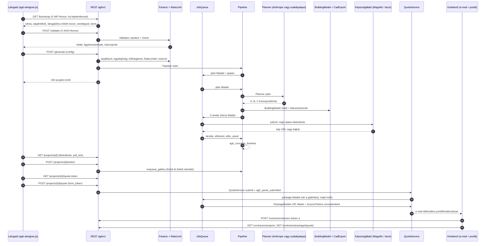
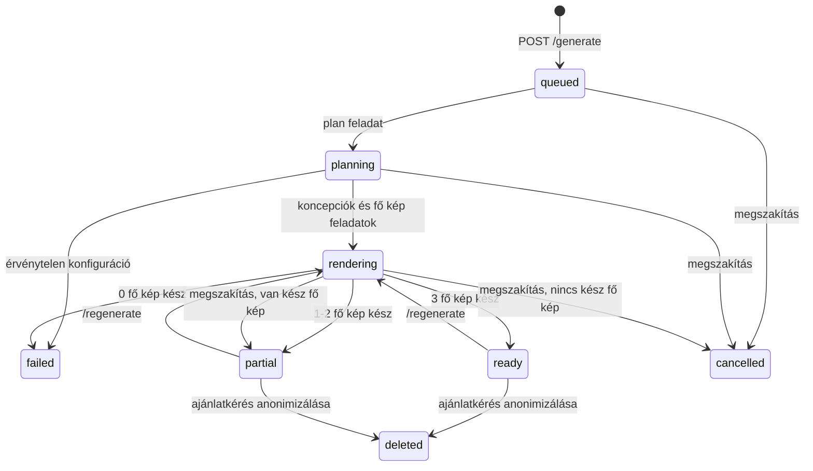

# AutoGroweHome – Architektúra

Ez a dokumentum az AutoGroweHome 1.0.0 WordPress-plugin belső felépítését írja le fejlesztőknek és üzemeltetőknek: a modulokat, a kéréstől a kivitelezői csomagig tartó adatfolyamot, a feladatsort, az állapotgépeket, a fájltárolást, a biztonsági modellt és a nyelvkezelést. Minden állítás a forráskódból származik (a 2026-10-11-i, harmadik javítási kör utáni állapot); a hivatkozott fájlok a plugin gyökeréhez képest értendők.

Kapcsolódó dokumentumok: [FEJLESZTOI-DOKUMENTACIO.md](FEJLESZTOI-DOKUMENTACIO.md) (REST API, hookok, épületmodell-séma, WP-CLI), [ADATBAZIS.md](ADATBAZIS.md) (táblák, opciók, cron, törlés), [API-INTEGRACIOK.md](API-INTEGRACIOK.md) (Magnific, Anthropic).

## Tartalom

1. [Rendszerkép röviden](#1-rendszerkép-röviden)
2. [Betöltés és indulás](#2-betöltés-és-indulás)
3. [Modultérkép](#3-modultérkép)
4. [Adatfolyam a kéréstől a kivitelezői csomagig](#4-adatfolyam-a-kéréstől-a-kivitelezői-csomagig)
5. [Feladatsor (JobQueue)](#5-feladatsor-jobqueue)
6. [Állapotok](#6-állapotok)
7. [Haladásszámítás](#7-haladásszámítás)
8. [Fájltárolás (Support/Storage)](#8-fájltárolás-supportstorage)
9. [Biztonsági modell](#9-biztonsági-modell)
10. [Nyelvkezelés (i18n)](#10-nyelvkezelés-i18n)
11. [Ellenőrzési státusz és ismert korlátok](#11-ellenőrzési-státusz-és-ismert-korlátok)

---

## 1. Rendszerkép röviden

| Jellemző | Érték | Forrás |
|---|---|---|
| Verzió | `AGH_VERSION = '1.0.0'` | `autogrowehome.php` |
| Adatbázis-séma verzió | `AGH_DB_VERSION = 5` (a v5 csak adatfrissítés: a tárolt kulcsok újratitkosítása, `Installer::upgrade_data()`) | `autogrowehome.php` |
| Követelmények | PHP 8.0 és a PHP **mbstring** kiterjesztés; WordPress 6.2 (plugin-fejléc). Ha bármelyik PHP-követelmény hiányzik, a plugin nem tölt be, csak adminüzenetet mutat. | `autogrowehome.php` |
| Névtér / autoload | `AutoGroweHome\` → `includes/<Modul>/<Osztály>.php` | `includes/Autoloader.php` |
| REST névtér | `agh/v1` (`AGH_REST_NS`) | `includes/Rest/RestController.php` |
| Táblaprefix | `{$wpdb->prefix}agh_` (13 tábla) | `includes/Installer.php` |
| Text domain | `autogrowehome`, forrásnyelv: magyar | `includes/Frontend/I18n.php` |
| Build-lépés | nincs: a JS/CSS kézzel írt, nem minifikált fájl az `assets/` mappában | `assets/` |

Fő elvek, ahogy a kód megvalósítja őket:

- **Minden lassú munka háttérfeladat.** A generálás, a csomagkészítés és az e-mail-értesítés a saját, adatbázisban tárolt feladatsoron fut (`includes/Generation/JobQueue.php`).
- **A geometria determinisztikus.** Az alaprajzokat, homlokzatokat és a CAD-exportot a paraméterekből számolt épületmodell (`agh-building-v1`) adja; az MI legfeljebb a helyiségterületeket módosíthatja ±20 %-on belül (`includes/Generation/BuildingModel.php`).
- **Külső szolgáltató nélkül is működik.** Anthropic-kulcs nélkül a szabályalapú tervező dolgozik (`Planner::plan_rules()`). Magnific-kulcs nélkül a teszt mód GD-vel jelölt vázlatképeket rajzol (`includes/Ai/TestImageProvider.php`), de ezt az adminban kifejezetten ki kell választani; automatikusan nem kapcsol be.
- **Minden fájl védett tárhelyen van,** és csak jogosultság-ellenőrző REST-végponton keresztül tölthető le (`includes/Support/Storage.php`, `RestController::asset_file()`).

---

## 2. Betöltés és indulás

`autogrowehome.php`:

1. Konstansokat definiál: `AGH_VERSION`, `AGH_DB_VERSION`, `AGH_FILE`, `AGH_DIR`, `AGH_URL`, `AGH_BASENAME`, `AGH_REST_NS`.
2. Ellenőrzi a futási követelményeket (PHP ≥ 8.0, `mbstring` + `mb_strtoupper`). Ha valamelyik hiányzik, adminüzenetet ír ki és kilép: nincs hook és nincs aktiválási rutin.
3. Regisztrálja az autoloadert, az aktiválási (`Installer::activate`) és a deaktiválási (`Installer::deactivate`) hookot.
4. `plugins_loaded` (prioritás 5) → `Plugin::boot()`.

`Plugin::boot()` (`includes/Plugin.php`) sorrendben:

| Lépés | Mit csinál |
|---|---|
| `Installer::maybe_upgrade()` | Ha az `agh_db_version` opció kisebb, mint `AGH_DB_VERSION`: táblák (dbDelta), egyszeri adatfrissítések (`upgrade_data()`, v5: `Secrets::upgrade_storage()`), szerepkörök, alapbeállítások. |
| `I18n::init()` | Szövegtartomány betöltése `init`-en (prioritás 1), `plugin_locale` szűrő. |
| `cron_schedules` szűrő | `agh_minute` ütemezés (60 s). |
| `agh_cron_queue`, `agh_process_queue_now` | `Plugin::cron_queue()` → `JobQueue::run(45.0)`, ha van függő feladat. |
| `agh_cron_daily` | `LicenseManager::check()`; a `Privacy::init()` ugyanerre köti a `Privacy::retention()` takarítást. |
| `rest_api_init` | `RestController::register()`. |
| Frissítési szűrők | `pre_set_site_transient_update_plugins` → `LicenseManager::filter_updates`; `http_request_args` → `LicenseManager::package_auth`; `upgrader_pre_download` → `LicenseManager::pre_download` (a frissítőcsomag SHA-256 ellenőrzése telepítés előtt). |
| `Privacy::init()` | GDPR-exportáló és -törlő, adatkezelési szövegjavaslat, napi takarítás. |
| `Admin::init()` vagy `Frontend::init()` | `is_admin()` szerint az egyik. |
| WP-CLI | `wp agh` parancs regisztrálása, ha `WP_CLI` fut. |
| Cron önjavítás | Ha `agh_cron_queue` vagy `agh_cron_daily` nincs ütemezve, újraütemezi. |

---

## 3. Modultérkép

Az `includes/` mappa 17 modulkönyvtárat és 3 gyökérosztályt tartalmaz.

| Modul (`includes/…`) | Osztályok | Feladat |
|---|---|---|
| *(gyökér)* | `Autoloader`, `Installer`, `Plugin` | PSR-4 betöltés; táblák, szerepkörök, aktiválás/deaktiválás, `drop_all()`; hookok bekötése. |
| `Admin/` | `Admin`, `Pages`, `Form` | 14 adminoldal (`agh-dashboard` … `agh-help`), beállítás-mentés (`admin-post.php?action=agh_save`), műveletek (`action=agh_action`), konfigurációs figyelmeztetések, titkos kulcsok mentése. |
| `Ai/` | `ImageProviderInterface`, `MagnificProvider`, `TestImageProvider`, `AnthropicProvider`, `Providers` | Képszolgáltatói szerződés és adapterek, Anthropic Messages API adapter, szolgáltató-nyilvántartás (`agh_image_providers` szűrő). |
| `Catalog/` | `Catalog` | Katalógus (`agh_catalog` tábla): tetőfedési márkák és termékek, anyagok, színkollekciók, stíluscsomagok, belsőépítészeti kollekciók, előbeállítások. Aktiváláskor BRAMAC-adatokat tölt fel `verified:false` jelöléssel. A BRAMAC márka (`Catalog::SPEC_ROOF_BRAND = 'bramac'`) mentéskor mindig kötelező és közzétett marad, és nem törölhető (`Catalog::delete()` → `false`). Mentéskor a be nem küldött adatkulcsok (pl. `required`, `recommended`, `note`) megmaradnak. Kötelező márka és ajánlott termék: `required_brand()`, `default_roof_product()`. |
| `Cli/` | `Command` | `wp agh queue [run]`, `wp agh status`, `wp agh retention`. |
| `Frontend/` | `Frontend`, `I18n`, `Strings`, `Help` | Shortcode-ok, kb. 4 KB-os betöltő, kivitelezői portál (`?agh-portal=1`), a tervező `bootstrap` adatai, nyelvváltás, JS-felirat-tömbök, gyorsbemutató és GYIK. |
| `Generation/` | `Pipeline`, `JobQueue`, `Planner`, `BuildingModel`, `FloorPlanSvg`, `GuideRenderer`, `CadExport` | Generálási folyamat, feladatsor, koncepciótervező, épületmodell, SVG-tervvázlatok, GD-tömegvázlat, CAD-exportálók (`agh_cad_exporters`, `CadExport::documents()`). |
| `License/` | `LicenseManager`, `Features`, `Payments`, `PaymentGatewayInterface`, `ExternalCheckoutGateway` | Ed25519-aláírt licencellenőrzés és frissítés, adatvezérelt csomagok (Starter / Professional / Agency; tulajdonosi mód), fizetési bővítési pont. |
| `Mail/` | `Mailer` | HTML e-mail sablonok helyőrzőkkel, `wp_mail()`. |
| `Params/` | `Definitions`, `Registry`, `Validator`, `RoomProgram` | 128 beépített paraméter 15 kategóriában és 25 helyiségtípus (mérve: `wp eval`), adminból felvett egyedi paraméterek (csak a `custom_params` funkcióval aktívak; nélküle az adatbázisban megmaradnak, de a sémában, ellenőrzésben, tervezésben és promptban nem szerepelnek), felülírások, tisztítás, konzisztencia-ellenőrzés, kötelező tetőfedési márka, automatikus helyiségprogram. |
| `Privacy/` | `Privacy` | WordPress személyesadat-exportáló és -törlő (lapozva), adatkezelési szövegjavaslat, napi megőrzési takarítás. |
| `Projects/` | `Repository` | Projektek, koncepciók, eszközök adatelérése; biztonságos törlés (`delete_project_safe`) és anonimizálás (`anonymize_project`). |
| `Prompt/` | `PromptEngine`, `DefaultModules`, `Color` | Moduláris, verziózott promptmotor (`agh_prompt_versions`), `{custom_params}` és `extras` modul, hosszkorlát (`MAX_PROMPT`), gyári promptok automatikus frissítése, `agh_prompt_variables` szűrő. |
| `Quote/` | `QuoteService`, `PackageBuilder`, `AccessTokens`, `Summary` | Ajánlatkérés űrlaptokennel, hozzájárulások, ZIP-csomag, címzettenkénti értesítés, kivitelezői hozzáférési tokenek, paraméter-összesítő. |
| `RateLimit/` | `RateLimiter` | Atomikus napi keret (IP / felhasználó / globális / burst), külön keret a koncepció-újragenerálásra, kiegészítő limitek. |
| `Rest/` | `RestController`, `Access` | Az `agh/v1` végpontok; látogatóhoz kötött nonce, vendégsüti, tulajdonos- és kivitelezői jogosultság. |
| `Stats/` | `Stats` | Napi aggregált számlálók (`agh_stats`), költségnapló (`agh_ledger`), költségkeret, statisztikai CSV. |
| `Support/` | `Settings`, `Secrets`, `Storage`, `Http`, `Logger`, `Schema`, `Ip`, `Util` | Beállítások (szolgáltatói URL-ek ellenőrzésével), titkosított kulcstárolás, védett fájltár, HTTP-burok, naplózás titokszűréssel, JSON-séma-ellenőrző, IP-feloldás és -hash, segédfüggvények (pl. `Util::webhook_token()`). |

Egyéb mappák:

| Mappa | Tartalom |
|---|---|
| `assets/js/` | `agh-loader.js` (betöltő), `agh-designer.js` (tervező), `agh-portal.js` (kivitelezői portál), `agh-admin.js`, `agh-pages.js` |
| `assets/css/` | `agh-designer.css`, `agh-admin.css`, `agh-pages.css` |
| `templates/` | `faq.php`, `pricing.php`, `portal.php`, `portal-page.php`, `emails/layout.php` |
| `languages/` | `autogrowehome.pot` és 15 nyelv `.po`/`.mo` fájlja |
| `tests/` | `integration-test.php`, `regression-x.php`, `regression-y1.php`, `regression-y2.php` |
| `tools/license-server/` | Külön telepítendő referencia-licencszerver (saját README-vel) |

---

## 4. Adatfolyam a kéréstől a kivitelezői csomagig

### 4.1 Áttekintő sorrenddiagram



### 4.2 Megjelenítés és betöltés

- **Belépési pontok** (`Frontend::init()`): `[autogrowehome]` és álneve, az `[autogrowehome_button]` (attribútum: `label`), valamint `[autogrowehome_portal]`, `[autogrowehome_faq]` és `[autogrowehome_pricing]`. A `general.floating_button` beállítás lebegő gombot tesz minden oldalra.
- `wp_footer`-ben csak egy JSON-konfiguráció (`Frontend::loader_config()`: `css`, `js`, `rest`, `wpNonce`, `floating`, `label`, `errBoot`, `vars`) és az `agh-loader.js` kerül az oldalra. A tervező CSS- és JS-csomagja az első kattintáskor töltődik be.
- **Megnyitás URL-ből:** a `#agh-open` hash az oldalbetöltéskor és későbbi `hashchange` eseményre is megnyitja a tervezőt, ugyanígy az azonos oldalra mutató `#agh-open` link is. Ez csak ott működik, ahol a betöltő be van töltve: a lebegő gombbal minden oldalon, egyébként a shortcode-os oldalakon. `window.AGH_open()` programból nyitja meg.
- **Bootstrap:** a tervező minden REST-hívásnál, a `GET /bootstrap`-nél is küldi a `X-WP-Nonce` fejlécet, ha a látogató bejelentkezett (`wpNonce`). Ha a WordPress lejárt nonce miatt elutasítja a kérést, a JS egyszer vendégként próbálja újra (`assets/js/agh-designer.js`).
- A bootstrap válasza (`Frontend::bootstrap_data()`): paraméterséma, alapértékek, feliratok, arculat, funkciókapcsolók, szolgáltatói állapot, napi keret, hozzájárulások. Az `X-AGH-Nonce` értékét a `RestController::bootstrap()` állítja elő (`Access::front_nonce(true)`); vendégnél ez a kérés hozza létre vagy újítja meg a vendégsütit is.

### 4.3 Paraméterezés és ellenőrzés (Params)

- `POST /validate` → `Validator::sanitize()`:
  - minden mezőt típus szerint tisztít, az ismeretlen kulcsokat eldobja;
  - a helyiséglistát `RoomProgram::sanitize()`-zel szűri (legfeljebb 40 helyiség), üres listánál `RoomProgram::auto()` javasol programot;
  - a `_explicit` lista rögzíti a látogató által kifejezetten beállított mezőket.
- **Kötelező tetőfedési márka** (`Validator::apply_roof_brand()`):
  - Magastetőnél a kötelező márka érvényes (`Catalog::required_brand()`): az első `required` jelölésű márka vagy a BRAMAC; a BRAMAC jelölése nem kapcsolható ki.
  - Ha nincs érvényes termék kiválasztva, a márka ajánlott terméke, ennek hiányában a tetőszínhez legközelebbi termék kerül a konfigurációba (`Catalog::default_roof_product()`). A látogató saját, érvényes választását nem írja felül.
  - Az automatikus választások a `_auto` listába kerülnek, és a `check()` információként jelzi őket.
  - Lapostetőnél nincs megkötés.
- `Validator::check()` eredménye: `errors` (blokkolja a generálást), `warnings`, `info`, `metrics`.
- `POST /rooms/auto` helyiségprogramot javasol; `POST /interpret` (csak Anthropic-kulccsal) a szabad szövegből paraméterjavaslatokat kér, az indoklással a látogató nyelvén (`Planner::interpret( $c, $lang )`).

### 4.4 Generálási kérés (`POST /generate`)

`RestController::generate()` ebben a sorrendben ellenőriz:

| # | Ellenőrzés | Hibakód (HTTP) |
|---|---|---|
| 1 | `designer` és `three_concepts` funkció engedélyezve | `agh_feature` (403) |
| 2 | Van működő képszolgáltató (`Providers::status()['image_ready']`) | `agh_not_configured` (503) |
| 3 | `Validator::sanitize` + `check`: nincs hiba | `agh_invalid` (422, `check` mezővel) |
| 4 | Duplikáció: azonos konfiguráció-hash ugyanattól a tulajdonostól `max(dedupe_minutes, cache_hours × 60)` percen belül → a meglévő projektet adja vissza, keret nélkül (`reused: true`). A `force` paraméter ezt kikapcsolja. | – (200) |
| 5 | Egyidejűség: az IP-hash-hez tartozó, 1 órán belül indított `queued`/`planning`/`rendering` projektek száma < `limits.concurrent_per_ip` (`agh_manage` jogú felhasználónál kihagyva). **Nem atomikus.** | `agh_limit` (429) |
| 6 | Költségkeret: `3 × costs.mystic_2k` belefér a napi és havi keretbe. **Nem atomikus.** | `agh_budget` (429) |
| 7 | `RateLimiter::reserve()`: minden hatókörben 1 egység, mindent vagy semmit (atomikus) | `agh_limit` (429, `limits` mezővel) |
| 8 | `Pipeline::start()`: projekt (`queued`/`validate`), `plan` feladat, `JobQueue::spawn()` | 202 |

A napi keret egysége a teljes kérés: **1 kérés = 3 koncepció = 1 egység**.

### 4.5 Tervezés (`plan` feladat)

`Pipeline::plan()`:

1. Ha a projekt már nem létezik, illetve `deleted` vagy `cancelled`, a feladat lezárul.
2. Állapot: `planning`/`prepare`. Újraellenőrzi a konfigurációt; hibánál `failed`/`validate` lesz, és visszaadja a lefoglalt keretet.
3. **Idempotencia:** csak akkor tervez, ha még nincs koncepció.
4. `Planner::plan( $c, <a projekt nyelve> )`:
   - Ha az Anthropic be van állítva és `anthropic.use_for_plan` igaz, kényszerített eszközhívással kér három koncepciót (`submit_concepts`), és a választ helyben, sémával ellenőrzi.
   - Hiba vagy érvénytelen válasz esetén a szabályalapú tervezőre vált.
   - A koncepcióneveket mindkét út a projekt nyelvén adja: az Anthropic-utasítás mind a 16 támogatott nyelvet ismeri (`Planner::language_name()`), a szabályalapú nevek pedig a projekt nyelvén fordítódnak (`I18n::with_locale`). Részletek: [API-INTEGRACIOK.md](API-INTEGRACIOK.md#5-anthropic).
5. **Megszakítás közben:** ha a látogató a tervezés alatt megszakította vagy törölte a projektet, nem jön létre koncepció. Ha a projekt költségmentes (`Pipeline::cost_free()`), a keret egyszer visszajár.
6. Koncepciónként (A, B, C): `BuildingModel::build()` → koncepciósor → `Pipeline::documents()` (4.9) → fő látványterv-eszköz (`hero`) és `render` feladat.
7. Ha a koncepciók létrehozása közben szakították meg, a sorban álló renderek leállnak. Egyébként `rendering`/`exterior` állapot jön; `limits.gallery_mode = all` esetén mindhárom galéria `pending` lesz.

### 4.6 Képgenerálás (`render` feladat)

`Pipeline::render()`:

1. **Szolgáltató kiválasztása** (`provider_for`): a feladat payloadjában vagy az eszközön rögzített szolgáltató, ha konfigurált; különben `Providers::active_image()`.
2. **Ha már van feladatazonosító,** csak az állapotot kérdezi le. Ha az eszköz és a feladat is régebbi a `magnific.timeout` értéknél (alap 420 s), átmeneti időtúllépési hibával zárul.
3. **Referenciakép:** `view` műveletnél, ha a szolgáltató tud referenciát, a koncepció kész fő képének előnézete (vagy eredetije) base64-ben.
4. **Geometriai vezetés:** `front`/`back`/`left`/`right` nézetnél, ha a szolgáltató támogatja és `magnific.structure_guidance` igaz, a `GuideRenderer` PNG-tömegvázlata.
5. **Felbontás:** a fő kép `gallery_mode = all` esetén `magnific.final_resolution`, egyébként `magnific.preview_resolution`, a csomag `max_resolution` limitjével.
6. **Webhook:** ha `magnific.use_webhook` igaz, a Magnific-kérés `webhook_url` mezője `…/agh/v1/webhook/magnific/<token>` (`Util::webhook_token()`).
7. `submit()` → az eszköz `running`; költségnapló (a teszt szolgáltatónál nincs). `consume()`:
   - `pending` → `JobQueue::wait()` (`magnific.poll_interval`, legalább 3 s; próbálkozást nem fogyaszt);
   - `completed` → letöltés (`Http::download`), tárolás, előnézet, `after_asset()`;
   - `failed` → `asset_failed()`.
8. **Hiba és tartalék:** nem átmeneti hibánál, ha van más konfigurált tartalék szolgáltató, az eszköz arra vált. Egyébként a `JobQueue::fail()` szabályai szerint újrapróbál, vagy az eszköz `failed` lesz.

### 4.7 Lezárás (`Pipeline::after_asset`)

- A koncepció `ready`, ha a fő képe kész, és `failed`, ha hibás. `pending` galériánál ilyenkor indul a galéria.
- A `rendering` állapotú galéria `ready` lesz, ha nincs nyitott nézet és legalább egy kész; `failed`, ha egy sem. Kiválasztott koncepciónál, `magnific.upscale_enabled` mellett ekkor indul a felskálázás.
- Ha **van koncepció**, mindhárom fő kép végleges, és a projekt `rendering` vagy `planning` állapotú, akkor a projekt `ready` (3 kész), `partial` (1–2) vagy `failed` (0) lesz, és egyszer lefut az **`agh_concepts_finished`** akció.
- Koncepció nélküli, megszakított (`cancelled`) vagy törölt projektet a kód nem véglegesít, és az akció sem fut le rá.
- **Visszatérítési szabály:** ha egy fő kép sem készült el és a projekt költségmentes (`Pipeline::cost_free()`: nincs könyvelt költség, és nem készült kép, archivált sem), a projekt egysége egyszer visszajár (`JobQueue::refund_project_once()`).

### 4.8 Kiválasztás, galéria, újragenerálás, felskálázás

- **Kiválasztás:** `POST /projects/{id}/select` → `selected_concept_id`. Ha a koncepció galériája még `none`: kész fő képnél azonnal `Pipeline::enqueue_gallery()`, különben `pending`, és a projekt `stage` értéke `gallery` lesz.
- **Galéria** (`enqueue_gallery()`):
  - Csak az élő (`queued`, `running`, `done`) képeket tekinti meglévőnek; az archivált, megszakított vagy hibás nézetek újra sorba kerülnek, nézetenként a következő verziószámmal.
  - Nézetek: a `limits.exterior_views` a `hero` nélkül; `detailed_gallery` funkció nélkül csak `front`, `back`, `aerial`; a csomag `max_exterior_views` limitje korlátoz; `evening` csak `night_lighting` paraméterrel.
  - Belső nézetek: a `render: true` helyiségek, legfeljebb `min(limits.interiors_max, max_interiors)`; összesen legfeljebb `limits.max_images_request` kép.
- **Újragenerálás** (`POST /projects/{id}/regenerate`): egy koncepció fő képét készíti újra, opcionálisan módosított konfigurációval (ilyenkor az épületmodell és a dokumentumok is újraépülnek).
  - Ellenőriz: `designer` és `three_concepts` funkció, működő képszolgáltató, költségkeret (`1 × costs.mystic_2k`).
  - **Külön napi keretet** foglal (`limits.gallery_rebuilds_per_day`, IP-nként és bejelentkezett felhasználónként; a `limits.global_daily` keretből nem fogy). A render feladat sorba állítása előtti bármely hibánál a keret visszajár.
  - A lefoglalt egység a render feladattal utazik (payload: `regenerate: true`, `reserved`). Pontosan ez az egység jár vissza, egyszer (`JobQueue::refund_job_once()`), ha az új fő kép költség nélkül véglegesen hibás lesz, vagy ha egy újabb újragenerálás vagy megszakítás felülírja, mielőtt bármi készült volna (`Pipeline::asset_cost_free()`). A projekt eredeti generálási egysége ilyenkor nem jár vissza.
  - A korábbi render-eszközök `archived` (hozzáférés: `admin`) vagy `cancelled` állapotba kerülnek.
- **Felskálázás** (`upscale` feladat): csak a Magnific-szolgáltatóval, a kiválasztott koncepció kész, nem teszt, még nem felskálázott és 3840 px alatti képeire. Az eredmény új fájl (`renders-<V>-<nézet>-v<n>-upscaled.<ext>`), `is_upscaled = 1`, a verzió nő.

### 4.9 Tervvázlatok és CAD-export

`Pipeline::documents()` koncepciónként:

| Eszköz (`kind`) | Nézet (`view`) | Feltétel | Előállító |
|---|---|---|---|
| `plan` (SVG) | `plan_<szint>`, `furnished_<szint>`, `dimensioned_<szint>`; `roof`, `elevations`, `section`, `roomlist` | `floorplans` funkció | `FloorPlanSvg::all()` |
| `doc` (CSV) | `roomlist_csv` | mindig | `FloorPlanSvg::rooms_csv()` |
| `doc` (JSON) | `building_json` | mindig (exporter `feature` = `''`) | `CadExport::documents()` → `json` |
| `doc` (DXF R12) | `dxf` | `export_advanced` funkció | `CadExport::documents()` → `dxf` |
| `doc` (egyéb) | az exporter azonosítója | az exporter `feature` kulcsa (alapértelmezés: `export_advanced`) | `agh_cad_exporters` szűrővel regisztrált exporter |

A `CadExport::documents()` a szűrővel regisztrált összes exportert lefuttatja. A hibásat kihagyja és naplózza (`cad` csatorna). A tervvázlatok `client` hozzáférésűek, ha `access.client_plan_previews` igaz, egyébként `contractor`; a `doc` eszközök mindig `contractor` szintűek.

**Kiszolgáláskor is érvényes funkciózár** (`RestController::feature_allows()`, `PackageBuilder`): tervvázlatfájl csak `floorplans`, DXF csak `export_advanced` funkcióval adható ki (például licenc-visszalépés után); a munkatárs (`agh_view_projects`) mindig hozzáfér.

### 4.10 Mentés és ajánlatkérés

| | Mentés (`POST /projects/{id}/save`) | Ajánlatkérés (`POST /projects/{id}/quote`) |
|---|---|---|
| Feltétel | `project_save` funkció | `contractor_email` funkció; érvényes űrlaptoken (`GET /projects/{id}/quote-token`); érvényes űrlap; a kötelező hozzájárulások |
| Hatás | `saved = 1`, opcionális név; vendégnél megújítja a vendégsütit | `agh_quotes` sor, hozzájárulási napló, `saved = 1`, kiválasztott koncepció, `package` feladat |
| Megőrzés | `legal.retention_projects_days` (mentett), `legal.retention_drafts_days` (nem mentett) | Ajánlatkéréses projekt nem törlődik automatikusan; az ajánlatkérés `legal.retention_quotes_days` után anonimizálódik |
| Hook | – | `agh_quote_submitted` (`$quote`, `$project`) |

`QuoteService::submit()` részletei:

- honeypot (`website` mező);
- **szerver által aláírt űrlaptoken** (`form_token` = `<unix időbélyeg>.<HMAC>`, a projekthez kötve): elutasítva, ha hiányzik, hamis, más projekté, 3 másodpercnél frissebb vagy 2 óránál régebbi (`FORM_MIN_SECONDS = 3`, `FORM_MAX_SECONDS = 7200`);
- név, e-mail, telefon, település ellenőrzése;
- hozzájárulások: `terms` (csak ha van ÁSZF-URL), `privacy` és `contact` kötelező, `marketing` opcionális;
- IP-nként napi 5 ajánlatkérés (hatókör: `quote`);
- opcionálisan a böngésző user agent-je a hozzájárulási naplóban (`legal.store_user_agent`, admin: Jogi és GDPR, alapból kikapcsolva).

### 4.11 Kivitelezői csomag, értesítés, portál

1. **`package` feladat** → `QuoteService::handle_job()`:
   - Ha a kiválasztott koncepció képei (vagy felskálázásai) még készülnek, a feladat 30 másodpercenként újra ellenőriz (próbálkozást nem fogyaszt), legfeljebb 20 percig (`PACKAGE_MAX_WAIT = 1200`).
   - Ezután `PackageBuilder::build()` a meglévő anyagból épít; a `00_OLVASSEL.txt` felsorolja a csomagba szánt, de hiányzó (még készülő vagy sikertelen) képeket.
   - ZIP-szerkezet: `01_Fokep/`, `02_Kulso_nezetek/`, `03_Belso_nezetek/`, `04_Tervvazlatok/`, `05_Dokumentumok/`. A `package_full` funkció nélkül a renderekből csak a fő kép, a `front` és a `back` kerül bele.
   - Anonimizált ajánlatkérésnél a feladat csak lezárul.
2. Siker után **`notify` feladat**. Ha a csomag véglegesen nem készül el, a notify ennek ellenére elindul.
3. **`notify`** → `QuoteService::notify( $quote, <feladat-azonosító> )`, címzettenként (`contractor.email`; `multi_contractor` funkcióval és `contractor.multi_enabled` mellett a `contractor.extra_emails` címei is):
   - a címzett korábbi linkjei visszavonódnak;
   - új, `contractor.link_hours` óráig érvényes, a címzetthez kötött `link` token készül;
   - e-mail megy a `contractor.lang` nyelvén;
   - a kézbesítés állapota címzettenként az `agh_quotes.recipients` oszlopba kerül.
   - **Ugyanannak a feladatnak az újrapróbálása csak a hibás címzetteknek küld újra**; az admin „Értesítés újraküldése (új link)” új feladat, tehát mindenkinek küld.
   - Az ügyfél-visszaigazolás ajánlatkérésenként egyszer megy ki (`contractor.client_confirmation`).
   - Állapot: `notified`; végleges hibánál `notify_failed`, a naplóban `forwarded_partial` vagy `forward_failed` esemény.
4. **Portál:** a hivatkozás `/?agh-portal=1#t=<token>` alakú. A token a `#` utáni részben van, így a böngésző nem küldi el a szervernek. A portál JS `POST /contractor/session` hívással cseréli munkamenet-sütire (`agh_cs`), majd betölti az adatokat. A link a lejáratig többször használható (szándékos, `AccessTokens` docblock).
5. **Visszavonás:** az admin „Hozzáférés visszavonása” gombja egy ajánlatkérés minden linkjét és az azokból nyitott munkameneteket visszavonja (`AccessTokens::revoke_quote( $quote_id, '', true )`).

---

## 5. Feladatsor (JobQueue)

### 5.1 Feladattípusok

| `type` | Létrehozza | Prioritás (kisebb = előbb) | `max_attempts` | Kezelő |
|---|---|---|---|---|
| `plan` | `Pipeline::start()` | 1 | 2 | `Pipeline::plan()` |
| `render` (`op: hero`) | `Pipeline::hero_asset()` | 2, 3, 4 (A, B, C) | `1 + limits.auto_retry_max` | `Pipeline::render()` |
| `render` (`op: hero`, újragenerálás) | `RestController::regenerate()` | 2 | `1 + limits.auto_retry_max` | `Pipeline::render()` |
| `render` (`op: view`) | `Pipeline::enqueue_gallery()` | 6 | `1 + limits.auto_retry_max` | `Pipeline::render()` |
| `render` (`op: interior`) | `Pipeline::enqueue_gallery()` | 7 | `1 + limits.auto_retry_max` | `Pipeline::render()` |
| `upscale` | `Pipeline::queue_upscales()` | 9 | 2 | `Pipeline::upscale()` |
| `package` | `QuoteService::submit()` | 3 | 3 | `QuoteService::handle_job()` |
| `notify` | `QuoteService::handle_job()` | 3 | 4 | `QuoteService::handle_job()` |
| `package` / `notify` (újraküldés) | Admin „Értesítés újraküldése (új link)” (`resend_quote`): `notify`, ha már van csomag, különben `package` | 3 | 3 | `QuoteService::handle_job()` |

### 5.2 Ki futtatja a feladatokat (workerek)

| Indító | Mechanizmus | Időkeret | Forrás |
|---|---|---|---|
| WP-Cron, percenként | `agh_cron_queue` (`agh_minute`) → `Plugin::cron_queue()` | 45 s | `includes/Plugin.php` |
| Loopback indítás kérés után | `JobQueue::spawn()`: egyszeri `agh_process_queue_now` esemény + `spawn_cron()` (ha `DISABLE_WP_CRON` nincs bekapcsolva) | 45 s | `includes/Generation/JobQueue.php` |
| Állapotlekérdezés | `GET /projects/{id}` → `JobQueue::poll_tick(8.0)`, ha `general.queue_tick_on_poll` igaz és a projekt `queued`, `planning`, `rendering`, `ready` vagy `partial`. Webhelyszintű atomikus lízing az `agh_poll_tick` opción: egyszerre egy tick fut. A futás végén a lízing felszabadul, a következő tick az előző befejezése után 5–6 s-mal indulhat; elakadt ticknél a lízing az indulás után 8 + 5 s-mal jár le. Bármely projekt feladatait viszi. | 8 s | `JobQueue::poll_tick()` |
| WP-CLI | `wp agh queue [run] [--seconds=<n>]` | alapértelmezés 50 s | `includes/Cli/Command.php` |
| Admin REST | `POST /admin/queue/run` | 20 s | `RestController::admin_queue_run()` |
| Admin művelet | „Feladatsor futtatása most” (`queue_run`), illetve „Értesítés újraküldése (új link)” (`resend_quote`) | 20 s / 15 s | `includes/Admin/Admin.php` |

**Párhuzamossági korlát:** ha `limits.max_parallel_jobs` > 0 (alapértelmezés 4; admin: Limitek és hozzáférés → „Egyszerre futó háttérfeladatok”, 0–50), a `JobQueue::run()` minden feladat előtt egy lízinghelyet foglal az `agh_job_slot_<n>` opciókon. Ha mind foglalt, a worker kilép. 0 = korlátlan.

### 5.3 Atomikus foglalás, zárolás, újrapróbálás

- **Foglalás** (`claim`): a futtatható sorok (`queued`, `waiting`, vagy lejárt zárolású `running`; `run_after <= most`) közül prioritás, majd azonosító szerint választ, és feltételes `UPDATE`-tel, véletlen `lock_token`-nel foglal. Minden foglalás növeli az `attempts` értéket.
- **Zárolás időtartama** (`JobQueue::lock_seconds()`): a beállított szolgáltatói időkorlátokból és újrapróbálásokból számolt legrosszabb eset + 60 s, legalább 150 s. Alapértékekkel **513 s** (mérve: `wp eval`).
- **Tulajdonosi írás:** a `complete()`, `wait()` és `fail()` csak az `id` + `lock_token` egyezésekor ír. Egy lejárt zárolású („stale”) worker így nem írhatja felül az újrafoglalt feladatot; ilyenkor figyelmeztetés kerül a naplóba (`queue` csatorna).
- **Várakozás** (`wait`): lekérdező feladat átütemezése, a payload kiegészítésével (`array_merge`); a foglaláskor növelt próbálkozásszámot eggyel csökkenti, így a várakozás nem fogyaszt próbálkozást.
- **Hiba** (`fail`): átmeneti hibánál, ha még van próbálkozás, `queued` állapot `min(300, 15 × 2^(attempts−1))` másodperces késleltetéssel; egyébként `failed` és hibanapló.
- **Megszakítás** (`cancel_project`):
  - a `queued`/`waiting` feladatok `cancelled` állapotba kerülnek, a hozzájuk tartozó render-eszközök is `cancelled` lesznek;
  - a még nem tervezett (`queued`/`planning`) projekt `cancelled` állapotú lesz;
  - a megszakított újragenerálás saját egysége visszajár, ha a képe még semmibe nem került (`Pipeline::asset_cost_free()`);
  - a projekt napi egysége bármely fázisban egyszer visszajár, ha a projekt költségmentes (`Pipeline::cost_free()`) és épp nem fut hozzá feladat;
  - a már futó feladat befejeződik, utána a `Pipeline` újraellenőrzi az állapotot.
- **Takarítás** (`cleanup`, a napi megőrzési futás része): 14 napnál régebbi `done`/`failed`/`cancelled` sorok törlése.

---

## 6. Állapotok

A pontos értékek a kódban beállított literálok alapján (grep).

### 6.1 Projekt (`agh_projects.status`, `stage`)

| `status` | Mikor |
|---|---|
| `queued` | Létrehozáskor |
| `planning` | A plan feladat elején |
| `rendering` | Koncepciók létrejötte után; újragenerálásnál |
| `ready` | Mindhárom fő kép kész |
| `partial` | 1–2 fő kép kész; vagy megszakítás, amikor már volt kész fő kép |
| `failed` | Érvénytelen konfiguráció a plan feladatban, vagy egyik fő kép sem készült el |
| `cancelled` | Megszakítás kész fő kép nélkül (`JobQueue::cancel_project()`, `RestController::cancel()`) |
| `deleted` | Anonimizált projekt „héja” (`Repository::anonymize_project()`): a sor megmarad; a fájlok, eszközök, koncepciók, feladatok és hozzáférések törlődnek, a konfigurációból minden szabad szöveg kikerül (`Repository::scrub_config()`). Az admin projektlistája nem mutatja. |

A `draft` oszlop-alapértéket a kód nem írja.

| `stage` | Mikor |
|---|---|
| `validate` | Létrehozáskor; és ha a plan feladat érvénytelen konfigurációt talál |
| `prepare` | A plan feladat alatt |
| `exterior` | Koncepciók létrejötte után; újragenerálásnál |
| `gallery` | Koncepció kiválasztásakor, illetve amíg galéria készül |
| `done` | Minden nyitott render lezárult; vagy megszakításkor |



### 6.2 Koncepció (`agh_concepts`)

| Mező | Értékek |
|---|---|
| `status` | `planned` → `ready` (a fő kép kész) vagy `failed` (a fő kép hibás); újragenerálásnál ismét `planned` |
| `gallery_status` | `none` → `pending` (galéria kérve, a fő kép még nincs kész) → `rendering` → `ready` (≥1 kész nézet) vagy `failed` (0 kész). Ha nem kerül sorba kép, közvetlenül `ready`. Megszakításkor a fő képre váró `pending` visszaáll `none`-ra. |
| `revision` | 1-ről indul, konfigurációmódosítással járó újragenerálásnál nő |

### 6.3 Eszköz (`agh_assets`)

| Mező | Értékek |
|---|---|
| `kind` | `render`, `plan` (SVG tervvázlat), `doc` (CSV / JSON / DXF / egyéb exporter) |
| `status` | `queued` → `running` → `done` vagy `failed`; továbbá `cancelled` (megszakítás, újragenerálás) és `archived` (újragenerálás utáni régi kész kép) |
| `access_level` | `client`, `contractor`, `admin` (archivált kép) |
| `view` | `hero`, `front`, `back`, `left`, `right`, `aerial`, `garden`, `evening`, `interior_<helyiség-id>`; tervvázlatnál és dokumentumnál lásd 4.9 |
| `provider` | `magnific`, `test`, regisztrált azonosító; tervvázlatnál `agh-svg`, dokumentumnál `agh` |

### 6.4 Feladat (`agh_jobs.status`)

`queued` → `running` → `done`; lekérdezés közben `waiting`; végleges hiba `failed`; megszakítás `cancelled`.

### 6.5 Ajánlatkérés és hozzáférés

| Tábla.mező | Értékek |
|---|---|
| `agh_quotes.status` | `pending` → `notified` vagy `notify_failed` |
| `agh_consents.consent_type` | `terms`, `privacy`, `contact`, `marketing`; továbbítási esemény: `forwarding` |
| `agh_consents.event` | `given`, `forwarded`, `forwarded_partial`, `forward_failed` |
| `agh_access.kind` | `link` (e-mailben küldött, címzetthez kötött token), `session` (portál-munkamenet) |

---

## 7. Haladásszámítás

`Pipeline::progress()` kizárólag valós eszköz- és feladatállapotokból számol (`GET /projects/{id}` → `progress`).

**Számlálók:** az `archived` és `cancelled` render-eszközök **nem számítanak**. A számlálók: `ext_total`, `ext_done`, `ext_failed` (külső render, a `hero`-t is beleértve), `int_total`, `int_done`, `int_failed` (`interior_*`), `failed` (összes hibás render), `docs` (minden nem render eszköz).

**Százalék:**

| Helyzet | `percent` |
|---|---|
| Még nincs koncepció | `null` |
| Van koncepció, nincs render | 10 |
| Van koncepció és render | `floor(10 + 90 × min(1, (ext_done + int_done + failed) / (ext_total + int_total)))`; a hibás kép lezártnak számít, így a 100 elérhető |

**Szakaszok** (`stages[]`: `id`, `label`, `state` ∈ `pending` / `active` / `done` / `error` / `skipped`; hibás képeknél `errors: N`):

| `id` | Állapotszabály |
|---|---|
| `validate` | `error`, ha `failed` + `validate`; `active`, ha `queued`; különben `done` |
| `prepare` | `done`, ha van koncepció; `active`, ha `planning`; `skipped`, ha megszakított; különben `pending` |
| `exterior` | Nincs külső render: `pending` (megszakítottnál `skipped`). Van: `active`, amíg `done + failed < total`; utána `error`, ha egy sem készült el, különben `done`. Hibás képeknél `errors`. |
| `interior` | Nincs belső render: `skipped`. Van: mint az `exterior`, `errors` jelöléssel. |
| `docs` | `done`, ha van dokumentum vagy koncepció; `skipped`, ha megszakított; különben `pending` |
| `process` | `pending` (megszakítottnál `skipped`), amíg nincs kész külső kép; `active`, ha a külső vagy belső szakasz aktív; különben `done` |
| `gallery` | `ready`/`partial` projektnél `done`, ha `stage = done`, különben `active`; egyébként `pending` (megszakítottnál `skipped`) |
| `done` | `done`, ha `ready`/`partial` és `stage = done`; `error`, ha `failed`; `skipped`, ha megszakított; különben `pending` |

A válasz tartalmazza a nyers számlálókat (`counts`) és a projekt feladatainak állapotonkénti darabszámát (`pending_jobs`).

---

## 8. Fájltárolás (Support/Storage)

**Alapkönyvtár** (`Storage::base_dir()`):

- Ha az `AGH_PRIVATE_DIR` konstans meg van adva: az a könyvtár (ajánlott webgyökéren kívül).
- Egyébként `<uploads>/agh-private-<16 véletlen kisbetű/szám>/`; az utótag az `agh_private_suffix` opcióban van.

**Védelem** (`Storage::ensure_private_dir()`): `.htaccess` (Apache tiltás, `Options -Indexes`), `web.config` (IIS), `index.php` (403), üres `index.html`, `agh-probe.txt`. A `Storage::health()` HTTP-n lekéri a próbafájlt; ha elérhető, az admin hibaüzenetet mutat (pl. Nginx). Az eredmény 1 órára az `agh_storage_health` tranziensbe kerül.

**Elrendezés.** A `Storage::put()` a fájlnévben minden `[A-Za-z0-9._-]`-n kívüli karaktert, így a `/` jelet is kötőjelre cseréli. A projektmappán belül ezért nincsenek almappák, hanem előtagok:

```text
<alapkönyvtár>/
├── .htaccess  web.config  index.php  index.html  agh-probe.txt
└── <projekt-uuid>/
    ├── plans-<V>-plan_0.svg, plans-<V>-furnished_0.svg, plans-<V>-dimensioned_0.svg, …
    ├── plans-<V>-roof.svg, plans-<V>-elevations.svg, plans-<V>-section.svg, plans-<V>-roomlist.svg
    ├── docs-<V>-roomlist_csv.csv, docs-<V>-building_json.json, docs-<V>-dxf.dxf, docs-<V>-<exporter>.<ext>
    ├── renders-<V>-<nézet>-v<verzió>.png|jpg|webp
    ├── renders-<V>-<nézet>-v<verzió>-preview.jpg
    ├── renders-<V>-<nézet>-v<verzió>-upscaled.png|jpg|webp   (felskálázás után)
    └── packages-<ajánlatkérés-uuid>.zip
```

(`<V>` = A, B vagy C; a felskálázott név a `Pipeline::upscaled_name()` szerint.) Az adatbázis relatív utat tárol. A `Storage::path()` elutasítja a `..`-ot és az abszolút utat, és `realpath`-tal ellenőrzi, hogy az eredmény az alapkönyvtáron belül marad.

**Kiszolgálás:** kizárólag `GET /assets/{uuid}/file` és `GET /contractor/package/{quote-uuid}`. Fejlécek: `X-Content-Type-Options: nosniff`, `Content-Security-Policy: default-src 'none'; style-src 'unsafe-inline'; img-src data:; sandbox`, `Cache-Control: private, max-age=600`. Képek és SVG `inline`, minden más `attachment`.

**Törlés:** `Storage::delete_project()` a teljes projektmappát törli. Eltávolításkor a saját `AGH_PRIVATE_DIR` könyvtárból csak a plugin UUID-nevű projektmappái, a próbafájl és azok a védőfájlok törlődnek, amelyek tartalma pontosan a pluginé; maga a könyvtár megmarad ([ADATBAZIS.md](ADATBAZIS.md#10-deaktiválás-és-eltávolítás)).

---

## 9. Biztonsági modell

### 9.1 Azonosítás és kérésvédelem

- **Bejelentkezett felhasználó:** a WordPress REST cookie-azonosítása `X-WP-Nonce` (`wp_rest`) fejlécet vár; nélküle a kérés vendégkérés. A tervező (`wpNonce` a betöltő-konfigurációban és a bootstrapban), a portál és az admin-JS ezt minden hívásnál küldi.
- **`X-AGH-Nonce`** (`Access::check_front_nonce()`): a nyilvános, állapotot módosító végpontok `permission_callback`-je. A nonce **a látogatóhoz kötött HMAC** (`Access::front_nonce()`):
  - képlet: `substr( HMAC-SHA256( 'agh_front|<tick>|<kötés>', wp_salt('nonce') ), 0, 24 )`;
  - kötés: a vendégsüti tokenje (`g:<token>`), vagy bejelentkezett felhasználónál `u:<id>|<munkamenet-token>`;
  - 12 órás tickekben számol, és az aktuális és az előző tick is érvényes (12–24 óra);
  - bejelentkezett felhasználónál a WordPress `agh_front` nonce is elfogadott.
  - Egy vendégnek kiadott nonce így más vendégnél használhatatlan. Indoklás a kódban: egyedi fejlécet más oldal csak CORS-előkéréssel küldhetne.
- **Admin:** képességellenőrzés (`agh_manage`, statisztikánál `agh_view_stats`); az admin űrlapoknál `check_admin_referer('agh_save_<oldal>')`, illetve `check_admin_referer('agh_action_<művelet>')`.

### 9.2 Vendég-tulajdonjog – `agh_gs` süti

- 48 hexadecimális karakteres véletlen token, `HttpOnly`, `SameSite=Lax`, HTTPS-en `Secure`.
- **Élettartam:** `max(1, legal.retention_drafts_days, legal.retention_projects_days)` nap (alapértékekkel 180).
- **Csúszó lejárat:** a bootstrap, a generálás, a mentés, az ajánlatkérés és a projektlista megújítja (`Access::touch_guest()`, `guest_token(true)`).
- Az első bootstrap hozza létre, ugyanabban a válaszban, amelyikben a hozzá kötött nonce is érkezik.
- Az adatbázisba csak `HMAC-SHA256(token, wp_salt('logged_in'))` kerül.
- `Access::is_owner()`: felhasználói azonosító, vendégnél időzítésbiztos hash-összevetés. `Access::is_staff()`: `agh_view_projects` képesség.

### 9.3 Fájlhozzáférés (`RestController::asset_permission`)

| Ki | Mit láthat |
|---|---|
| Munkatárs (`agh_view_projects`) | Minden eszközt, teljes méretben |
| Jogosult kivitelező (9.4) | A hozzá rendelt projektek eszközeit; tervvázlatot csak `floorplans`, DXF-et csak `export_advanced` funkcióval |
| Tulajdonos | Csak az ügyfélnek látható eszközöket: a fő képet mindig; a galérianézeteket, ha `access.client_gallery_previews`; a `client` szintű tervvázlatokat, ha `floorplans` is engedélyezett. Dokumentumot soha. |
| Tulajdonos, teljes méret | `access.client_download = all`: minden látható kép; `hero`: csak a kiválasztott koncepció fő képe, `hero_download` funkcióval; `none`: semmi |

### 9.4 Kivitelezői hozzáférés

- **Tokenek** (`AccessTokens::create()`): 64 hexadecimális karakter; az adatbázisban csak `HMAC-SHA256(token, wp_salt('secure_auth'))` és a címzett e-mail-címének HMAC-je (`recipient`).
- A `link` token a lejáratig többször használható, és az URL `#t=` részében utazik.
- `POST /contractor/session`: IP-nként napi 30 próbálkozás; új `session` token `agh_cs` sütiben (`HttpOnly`, `SameSite=Strict`, HTTPS-en `Secure`, `contractor.session_hours` óra), a link címzettjét örökölve.
- **Hatókör** (`Access::contractor_quotes()`):
  - munkatárs: minden ajánlatkérés (a portálon a legutóbbi 50);
  - csak `agh_view_packages` képességű felhasználó (pl. `agh_contractor` szerepkör): azok az ajánlatkérések, amelyek értesítője az ő e-mail-címére sikeresen kiment (`agh_quotes.recipients`); a címzettkövetés előtti ajánlatkérések közül azok, amelyeknek ő jelenleg címzettje;
  - linkes munkamenet: csak a saját ajánlatkérése.
- **Visszavonás:** új link ugyanannak a címzettnek; admin „Hozzáférés visszavonása”; kijelentkezés (csak a munkamenet); anonimizálás (az ajánlatkérés linkjei és munkamenetei); projekttörlés (a projekt hozzáférési sorai törlődnek).

### 9.5 Titkok, naplózás, kimenő kérések

- **API-kulcsok** (`includes/Support/Secrets.php`):
  - elsődlegesen `wp-config.php`-konstansból (`AGH_ANTHROPIC_API_KEY`, `AGH_MAGNIFIC_API_KEY`, `AGH_LICENSE_KEY`), különben titkosítva az `agh_secrets` opcióban;
  - titkosítás: libsodium `secretbox` (`s1:`), tartalékként AES-256-CBC + HMAC-SHA256 külön levezetett titkosító és MAC kulccsal (`o2:`); a régi `o1:` formátum olvasható, és olvasáskor újratitkosul;
  - mesterkulcs: ha az `AGH_SECRET_SALT` meg van adva és nem üres, **csak abból** (`sha256( 'agh-secrets|salt|' . AGH_SECRET_SALT )`), így a WordPress-sók cseréje nem érinti a tárolt kulcsokat; egyébként a WordPress `auth` és `secure_auth` sójából (ekkor a sócsere után a tárolt kulcsok újra megadandók);
  - visszafejtéskor a jelenlegi kulcs, a korábbi kevert levezetés, végül a csak WordPress-sós levezetés kerül sorra; a régi kulccsal vagy formátumban tárolt érték olvasáskor újratitkosul, az 5-ös sémaverzióra lépéskor pedig egyszer az összes (`Secrets::upgrade_storage()`).
- **Napló** (`Logger::redact()`, `redact_text()`) – a kitakarás az üzenetben és a kontextusban is működik:
  - kulcs-, token-, jelszó- és képmezők;
  - `sk-ant-…` és `sk-…` kulcsok, `Bearer` tokenek;
  - `x-api-key`, `api_key`, `token=`, `password` és hasonló értékek;
  - `AGH-…` licenckulcsok, valamint 32+ karakteres, kulcsszerű sztringek (a UUID-k olvashatók maradnak).
- **Kimenő HTTP** (`includes/Support/Http.php`):
  - hitelesítő fejlécet hordozó kérés nem követ átirányítást; a hívó a `$opts['redirection']` paraméterrel csak csökkentheti az átirányítások számát (a licenc- és frissítéshívások 0-val futnak);
  - a szolgáltatói eredményfájl letöltése lépésenként `wp_safe_remote_get`-tel történik, legfeljebb 3 átirányítással, csak HTTPS-en, méretkorláttal és képtípus-ellenőrzéssel.
- **Szolgáltatói URL-ek** (`Settings::secure()`): az `anthropic.endpoint` és a `magnific.base_url` csak hitelesítő adat nélküli, abszolút `https://` URL lehet; a Magnific-végpontok csak relatív útvonalak egyetlen közös szabály szerint (`Settings::ENDPOINT_PATH_PATTERN` = `#^(?:/[A-Za-z0-9_\-]+)+$#`, pont nélkül; ugyanezt használja a `MagnificProvider::status()`). Érvénytelen érték helyett a gyári alapérték érvényes, olvasáskor és mentéskor is.
- **Licencellenőrzés:** a licencszerver hibája (elérhetetlenség, érvénytelen aláírás, a kéréssel nem egyező válasz) csak működő licencnél (előző állapot `active` vagy már `unreachable`) indít türelmi időt (`unreachable`, `LicenseManager::GRACE_DAYS = 14` nap az utolsó sikeres ellenőrzéstől); inaktív vagy lejárt licencet nem kapcsol vissza. A licenc- és frissítéshívások nem követnek átirányítást.
- **Licencfrissítés:** csak HTTPS licencszerverrel. Az aláírt válaszban kapott SHA-256-tal a `LicenseManager::pre_download()` a csomagot telepítés előtt ellenőrzi; a licenckulcs csak fejlécben (`X-AGH-License`) utazik.

### 9.6 Egyéb védelmek

- **IP-adatok:** nyers IP-cím nem kerül tárolásra, csak `HMAC-SHA256('agh-ip|' . hálózat, wp_salt('nonce'))` (`Ip::hash`). A hálózat IPv4-nél a teljes cím, IPv4-mapped IPv6-nál az IPv4-cím, egyéb IPv6-nál a `/64` előtag (`Ip::network`). Továbbított fejlécet csak a `limits.trusted_proxies` listán szereplő proxytól fogad el.
- **Keretek:** a napi keret, az újragenerálási keret és a kiegészítő limitek feltételes `UPDATE … WHERE hits < limit` utasítással foglalnak (atomikus). Mérve (a javítási körök előtt): 12 párhuzamos kérés 3-as kerettel → 3 × HTTP 202, 9 × HTTP 429. **Az egyidejűségi és a költségkeret-ellenőrzés nem atomikus.**
- **MI-kimenet:** az Anthropic-válasz csak helyi sémaellenőrzés után kerül felhasználásra. A látogató szövege `<client_text>` blokkban utazik.
- **Webhook:** az útvonal titkos tokent tartalmaz (`/webhook/magnific/<32 hex>`, `Util::webhook_token()`); hibás tokenre 404 a válasz. A payloadnak nem hisz, csak sürgeti a lekérdezést.
- **Ajánlatkérő űrlap:** honeypot, projekthez kötött, aláírt űrlaptoken minimális és maximális korral, IP-limit.
- **CSV-injekció:** a CSV-cellák `=`, `+`, `-`, `@` kezdetnél aposztrófot kapnak.

---

## 10. Nyelvkezelés (i18n)

| Elem | Megvalósítás | Forrás |
|---|---|---|
| Forrásnyelv | Magyar; minden felirat `autogrowehome` domainnel | teljes kódbázis |
| Betöltés | `load_plugin_textdomain()` az `init` akción (prioritás 1) | `I18n::load()` |
| Pontosan egy nyelv | `I18n::apply()` a `languages/autogrowehome-<locale>.mo` fájlt tölti be; magyarnál `NOOP_Translations` | `I18n::apply()` |
| Támogatott nyelvek | `hu_HU`, `de_DE`, `en_US`, `ru_RU`, `es_ES`, `pl_PL`, `hr`, `ro_RO`, `sl_SI`, `sk_SK`, `cs_CZ`, `fr_FR`, `it_IT`, `nl_NL`, `sr_RS`, `uk` | `I18n::SUPPORTED` |
| Admin által rögzített nyelv | `general.frontend_locale` (`auto` = webhely nyelve) a `plugin_locale` szűrőn; a wp-adminra nem hat | `I18n::frontend_locale()` |
| Látogatói nyelvváltás | `?agh_lang=<locale>` (minden tervezőhívásban), illetve `GET /bootstrap?lang=`. **Csak a `multilang` funkcióval** működik (`I18n::request_switch()`), és csak a `general.enabled_locales` listájában szereplő nyelvre; e funkció nélkül a nyelvválasztó rejtve van. | `I18n::load()`, `RestController::bootstrap()` |
| JavaScript-feliratok | PHP-ból érkeznek (`Strings::designer()`, `Strings::portal()`); JSON-fordítófájl nem kell | `includes/Frontend/Strings.php` |
| E-mailek | `I18n::with_locale()`: kivitelezői levél `contractor.lang`, ügyfél-visszaigazolás az ajánlatkérés nyelvén | `QuoteService::notify()` |
| AI-értelmezés | Az indoklások és ellentmondások a látogató nyelvén (`Planner::interpret( $c, $lang )`; üres `$lang` esetén a kérés nyelve) | `Planner::interpret()` |
| Koncepciónevek | Anthropic: a projekt nyelvének angol neve a 16 nyelv mindegyikére (`sr_RS`: „Serbian (Cyrillic script)”), ismeretlen locale esetén nyelvelőtag szerint, végül magyar. Szabályalapú tervező: a nevek és szlogenek a projekt nyelvén. | `Planner::language_name()`, `Planner::plan_rules()` |
| Egyedi paraméterek | Nyelvenkénti címkék a `translations` kulcsban | `Registry::fields()` |

Fordítási munkafolyamat: [FEJLESZTOI-DOKUMENTACIO.md](FEJLESZTOI-DOKUMENTACIO.md#9-fordítási-munkafolyamat).

---

## 11. Ellenőrzési státusz és ismert korlátok

**Mért** (tesztkörnyezet: PHP 8.3.6, WordPress 7.2-alpha, SQLite Database Integration 3.1.0; a 3. javítási kör utáni eredmények a koordinációs jegyzet szerint):

- integrációs tesztsor 147/147;
- `regression-x` 120/120, `regression-y1` 116/116, `regression-y2` 71/71;
- licencszerver-önteszt 32/32; PHP-lint 0 hiba;
- párhuzamos keretteszt (12 kérés, keret 3 → 3 × 202, 9 × 429; a javítási körök előtt mérve);
- böngészős végponttól végpontig tartó teszt asztali és mobil nézetben.

E dokumentum írásakor a teszteket nem futtattuk újra.

**Nem ellenőrzött élesben:**

- valós Magnific- és Anthropic-hívás (a tesztek `pre_http_request` szűrővel, a dokumentált szerződés szerint szimulálnak);
- tényleges e-mail-kézbesítés;
- MySQL/MariaDB (csak SQLite-on futott);
- éles tárhely valódi cronnal.

Beépített fizetési szolgáltató nincs, csak bővítési pont. A BRAMAC-katalógus `verified:false` jelölésű; a felület a nem ellenőrzött terméket „Gyártói ellenőrzésre vár” jellel mutatja.

**Ismert korlátok a kódban:**

- **Nem atomikus ellenőrzések:** a per-IP egyidejűségi limit és a költségkeret egyszerű lekérdezés, párhuzamos kéréseknél túlléphető (a napi keret atomikus). Az újragenerálás nem fogy a `limits.global_daily` keretből.
- **Vendég-nonce:** az első bootstrapig nincs sütihez kötve; a sütit és a hozzá kötött nonce-ot ugyanaz a válasz adja.
- **Kivitelezői link:** a lejáratig többször használható (szándékos).
- **Épületmodell:** a javítási kör mérése szerint (21 alapkonfiguráción és 444 véletlen modellen) maradt hiba keskeny főépületű U-alakú alaprajznál, és a többszintes házak területeltérés-figyelmeztetésénél.
- **Bejelentkezett felhasználó fájl-URL-jei:** a kép- és ZIP-hivatkozások `_wpnonce` paramétert tartalmaznak (`RestController::asset_url()`), így a nonce a böngészőelőzménybe és a naplókba kerülhet.
- **Kimenő letöltés:** nincs gazdagép-engedélylista; a `wp_safe_remote_get` ellenőrzése a DNS-újrakötés (rebinding) ellen nem nyújt teljes védelmet.
- **GDPR-eszközök:** a vendégprojektek (süti alapján) e-mail-cím szerint nem kereshetők; ezeket a megőrzési futás törli.
- **Admin projektlista:** az anonimizált (`deleted`) projekteket nem listázza és nem szűrhető rájuk.
- **Egyedi GYIK és gyorsbemutató:** a szerkesztett szöveg egynyelvű; a gyári szövegek fordítottak.
- **Licenc:** PHP-kódként egy rendszergazda a kód módosításával megkerülheti (alapvető korlát).
